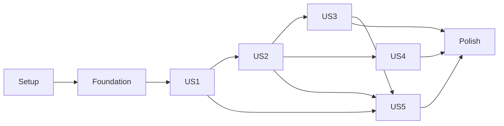

# Tasks: контекстный редактор, удаление и очистка проекта

**Input**: [plan.md](plan.md), [spec.md](spec.md), [research.md](research.md), [data-model.md](data-model.md), [API](contracts/geometry-api.md), [JSON/storage](contracts/project-file.md), [UI](contracts/workflow-ui.md), [quickstart.md](quickstart.md).

**Область**: FR-035–FR-038 и изменения FR-003/005/008/009/027, SC-014–SC-017, уточнения I1/U1 для FR-010/033 и SC-012/017. Новые задачи T122–T176: **55/55 выполнены** 2026-10-12. Все 75 завершённых задач T047–T121 сохранены ниже без изменения строк и статусов; исходный снимок — [history/vertex-safety/tasks.md](history/vertex-safety/tasks.md). T001–T046 — в [history/contour-v2/tasks.md](history/contour-v2/tasks.md). Старые 91 e2e не подтверждают этот инкремент. Уже удалённые selected X/Y не реализовывать заново; сохранить правку и проверить отсутствие регрессии.

**Синхронизация плана 2026-10-12**: учтены R10, точная идентичность fixed/released диапазона, различие 422/invalid/unresolved, G30i и защита завершения importV3/File.text. Экспорт готового результата остаётся синхронным; новые endpoint или искусственные задержки экспорта не нужны. Число задач и выполненная история сохранены.

**Ограничения**: только быстрые Chromium Playwright e2e на малых изолированных fixtures и build/typecheck. Performance, нагрузочные, стресс-тесты, benchmark, pytest и отдельные unit/property/contract-наборы **не запускать**, в том числе через общий скрипт. Один worker, test timeout 15 с, action timeout 5 с. Пользовательский проект не менять. Генерация задач не запускает проверки. Примеры неутверждённой конституции не вводят дополнительных требований.

**Формат**: `- [ ] TNNN [P?] [USN?] Действие с точными путями`. Пути относительно корня проекта. [P] означает независимую работу с разными файлами после указанных предпосылок, не параллельный запуск e2e и не поручение автоматически запускать агентов. Каждая группа G — несколько коротких тестов, не один длинный тест.

**Проверки перед реализацией**: спецификация прямо требует e2e, поэтому они включены. Новые поведенческие тесты писать первыми и подтвердить ожидаемый функциональный провал до соответствующей реализации; для уже реализованной гарантии сохранить успешную регрессию, не добиваться искусственного провала. Проверки API-контрактов выполняются внутри быстрых браузерных e2e с настоящим FastAPI, без отдельного contract suite.

## Phase 1: Setup

**Цель**: подготовить малые сценарии и сохранить действующее окружение, без переинициализации проекта.

- [X] T122 Проверить разрешённые scripts в `frontend/package.json`, параметры `frontend/playwright.config.ts` и команды `specs/001-project-stages/quickstart.md`: Chromium, один worker, 15 с/5 с, отсутствие косвенного запуска запрещённых наборов; не обновлять зависимости и не запускать проверки производительности.
- [X] T123 Подготовить в `frontend/tests/fixtures/projects.ts` малые планы двух соседних комнат с общей стеной, внешней стеной/общим узлом и независимой точкой; void и его повреждённую роль, цепи/range/fixed/released/legacyUnbound, трёхлучевой узел и несвязанную стену, полный v3 с detached rooms/restorePoint/raw/pending graphV3 и legacyV2. Перевести confirmRoom на реальный выбор внутренней точки через существующий инструмент помещения; seed использовать только для подготовки, не вместо проверяемого действия. Для G24r подготовить цепь из трёх участков, диапазон двух участков и отдельные версии fixed/released условия диапазона вместе с отличным условием полной длины; предусмотреть внутренний split и чужую вершину. Не создавать одновременно дубли kind+target.

## Phase 2: Foundational

**Цель**: общие схемы, runtime состояния и интерфейсы принятия результата. Все истории зависят от завершения этой фазы.

- [X] T124 [P] Расширить `backend/geometry/graph_models.py` моделями deletion-preview и командами deleteRoom(topologyKey, impactKey), deleteVoid(voidId, impactKey), deleteConstraint(constraintId), сохранив старый union. Зафиксировать «schemaVersion=3», «до 2100 вершин, 6300 сегментов/цепей, 12600 условий, 20 voids; файл/запрос до 2 МиБ», target room|void, status ready|invalid, «На ready impact обязателен, на invalid равен null», уникальные отсортированные ID и disappearedRoomKeys⊆affectedRoomKeys; не вводить геометрический ремонт при чтении. Сохранить категории отказов существующего API: входной GraphSnapshot/форма запроса → 422; некорректный кандидат новой команды → HTTP 200/invalid с basis; структурно допустимое несогласуемое размерное намерение → HTTP 200/unresolved. Ручные 0°/180°/360° не превращать в новый запрет чтения схемы или HTTP 422.
- [X] T125 [P] Согласовать `frontend/src/domain/plan/types.ts` и `frontend/src/domain/plan/schema.ts` с T124 по зафиксированному API: новые command discriminators и preview types, прежний GraphPending «{kind:"graphV3", commandId, command, basisGraph, targetDraftRevision}», LegacyPending и addTemplate/unmarkVoid сохраняются. Неизвестный тип/будущая версия отвергаются без записи; «Пустой снимок допустим», «При удалении нет висячих ссылок; новый кандидат не создаёт совпадающих координат»; ID уникальны внутри каждого снимка, runtime context/history/epochs в JSON не добавляются.
- [X] T126 [P] Создать `frontend/src/domain/plan/editor-state.ts` с discriminated EditorContext none|project|tool|vertex|segment|range|room|void|constraint|angle, ToolInteraction idle|connect|rangeFirst|rangeSecond|angleFirst|angleSecond|angleSector|move|placeVertex и KeyboardCanvasState по data-model. Сохранить «firstVertexId: string | null», «constraintId?: string», «sector: "cw" | "ccw"», «activeTarget (vertex/segment/room/void/constraint/range/arc либо null)», режим «navigation/placement/movePreview». «Выбранное помещение расчёта selectedRoomId независимо от EditorContext», «Отображается одна контекстная панель», «Context не сериализуется»; добавить чистое согласование ссылок с принятым graph/faces. Для rangeFirst хранить chainId, для rangeSecond — chainId/firstVertexId; готовый range context содержит chainId/startVertexId/endVertexId/constraintId?. «Оба ID — разные существующие узлы одной цепи»; конец упорядочивается вдоль цепи независимо от кликов. Утрата цепи/конца/принадлежности сбрасывает range-состояния; до пары поле длины отсутствует, выбор не сериализуется. Зафиксировать переход «После пары ToolInteraction становится idle, а контекст range хранит startVertexId/endVertexId в порядке обхода chain.segmentIds, независимо от порядка кликов». Проверять диапазон по ссылкам цепи, а не по сортировке ID/пикселей; дополнительный split между существующими концами сохраняет допустимый контекст.
- [X] T127 [P] Создать в `frontend/src/domain/plan/project-lifecycle.ts` общий runtime lifecycle/write epoch и контракт SessionHistory: «Runtime история ограничена прежними 20 действиями», записи «{kind:"edit"|"clearProject", before:ProjectDocumentV3}», «Результаты, loading, DOM references и epochs туда не входят», «Undo никогда не уменьшает его». Определить синхронное уведомление об инвалидировании и принятых переходах, не добавляя lifecycle-поля в ProjectDocumentV3. Описать runtime ImportPreview: «Чтение файла захватывает projectId, lifecycleEpoch, собственный requestId и текущую documentRevision», «Кандидат файла и состояние чтения не входят в документ/Undo». Новый запрос чтения отменяет актуальность предыдущего; epoch и requestId не заменяют проверку локальной ревизии при подтверждении.
- [X] T128 После T124–T127 подключить общий контракт состояний/событий к `frontend/src/domain/plan/useGraphProject.ts` и `frontend/src/components/canvas/GraphWorkflow.tsx`: единый переход принятого документа сообщает graph/faces, причину и lifecycle epoch; UI может одновременно очищать утраченные context/interaction/focus/diagnostics. Отклонённый результат не выдаётся за принятое удаление; прежние этапы и изменение selectedRoomId сохраняются. Единый переход покрывает «успешной команды, обычного Undo, восстановления или подтверждённого импорта»; проверять существование chainId/концов range и принадлежность одной непрерывной цепи. «При clear/Undo clear все transient состояния сбрасываются независимо от восстановленных ID».
- [X] T129 После T124–T125 подготовить typed вызов read-only deletion-preview и новые команды в `frontend/src/domain/plan/commands.ts`, используя `frontend/src/api.ts`: requestId/commandId, draftRevision/basisKey и строгий ответ, существующая обработка пустого/HTML/оборванного JSON. API-helper не создаёт pending/Undo и не вычисляет серверный каскад повторно на клиенте.

**Checkpoint**: общий фундамент готов; нет нового storage format, migration или библиотеки. T124/T125 согласуются контрактом, остальные совместные изменения начинаются после их завершения.

## Phase 3: US1 — Пройти проект по четырём этапам (P1): очистка и восстановление, MVP

**Цель**: из любого этапа безопасно очистить тот же проект, отменить очистку в текущей сессии и сохранить правильное состояние после reload.

**Независимая проверка**: полный изолированный документ → отмена подтверждения без изменений → подтверждённый clear с прежними id/name/address → один Undo возвращает inputs/settings/confirmed/pending без автоматического запроса; отдельный clear/save/reload остаётся пустым без старого restorePoint/Undo. Старый ответ после clear и clear→Undo не применяется; запоздалое чтение файла не открывает preview и не показывает старую ошибку. Новый явный импорт работает.

### Быстрые e2e до реализации

- [X] T130 [P] [US1] Добавить в `frontend/tests/project-document.spec.ts` короткие G28b/G29/G29b/G30b с префиксом «clear project »: полный сброс/экспорт/reload/закрыть-открыть, Undo с graphV3/legacyV2 intent и raw, правка после clear и две последовательные отмены; реальный Web Lock с ожидающим старым save, уже записанная старая ревизия, quota и конфликт другой вкладки. Проверить отсутствие beforeClear/history в файле и сохранность чужих проектов; схему новых сохранённых pending проверять чтением/round-trip, исполнение delete-команд покрывает US2. В round-trip отдельно убедиться, что ImportPreview/requestId/epoch и незавершённые rangeFirst/rangeSecond/пара концов отсутствуют в JSON, а применённый chainLength.target.range сохраняется.
- [X] T131 [P] [US1] Добавить в `frontend/tests/project-stages.spec.ts` короткие G28/G30/G30i с префиксом «clear project »: clear доступен на всех четырёх этапах и при pending, отмена не меняет данные, успех закрывает меню/выделения и переводит в object; задержанные validate/command/legacy retry/optimize/layout после clear и clear→Undo отклоняются, включая success/error/finally при восстановленных прежних ключах. Интерцепты только управляют задержкой/ошибкой, не подменяют успешную геометрию; каждый асинхронный путь/вариант — отдельный тест. Для G30i управляемо завершать File.text успехом/ошибкой после clear, clear→Undo, закрытия проекта или более нового чтения; старый preview/ошибка не появляется и новый документ не меняется. Новый импорт после очистки работает. Задерживается только чтение, разбор/миграция/preview настоящие; без sleeps и измерений времени. Экспорт SVG/CSV синхронный: проверить блокировку старого результата перед download, не задерживать несуществующий endpoint. Часть G30 для deletion-preview реализуется и принимается в T141/T158 после US2.

### Реализация

- [X] T132 [P] [US1] После написания T130–T131 реализовать чистые clear/Undo преобразования в `frontend/src/domain/plan/project-lifecycle.ts`: «Сохранить schemaVersion=3, id, name, address и текущую documentRevision», «draftRevision=предыдущая+1», «plan.draft=emptyGraph(), pendingEdit=null, restorePoint=null; rooms=[], selectedRoomId=null; requestedStage=object; viewport — текущие defaults нового проекта». Undo восстанавливает полный before с текущей documentRevision, новой draftRevision=current+1 и переназначенным pending.targetDraftRevision; «Pending не запускается», «variants → rules, неготовый/зависимый pending → object». Clear не создаёт новый ID или комнату.
- [X] T133 [P] [US1] После написания T130–T131 расширить `frontend/src/domain/plan/storage.ts` отменяемой записью под Web Lock: optional predicate проверяется непосредственно до CAS/setItem; результат saved(document)|skipped, ошибки отдельно. Сохранить expectedRevision, r+1, остальные проекты, прежний отказ без Web Locks и совместимость существующих callers; не удалять v2/legacy backups.
- [X] T134 [US1] После T132–T133 изменить очередь persist в `frontend/src/domain/plan/useGraphProject.ts`: каждый snapshot захватывает writeEpoch, superseded пропускается до вызова и внутри lock, все счётчики сбалансированы; уже совершившаяся старая запись передаёт только новую revision, не старый payload/onSaved. «Сохранено» относится только к последней актуальной записи; clear/Undo не снимают conflict и не обходят CAS; последний актуальный save при unmount не теряется.
- [X] T135 [US1] Реализовать hook-level clearProject и Undo clear в `frontend/src/domain/plan/useGraphProject.ts`: одно завершённое действие/одна запись history, синхронное повышение lifecycle/write epoch при обоих переходах, сохранение до/после с текущими revision, восстановление intent без запуска. Оградить validate/command/legacy retry после каждого await и success/error/finally по live owner/epoch и прежним токенам; разрешена новая read-only validate. «Закрытие проекта/размонтирование или reload уничтожают историю»; предыдущая история и Undo последующих правок сохраняются.
- [X] T136 [US1] Создать `frontend/src/components/canvas/ProjectMenu.tsx` и подключить в `frontend/src/components/canvas/GraphWorkflow.tsx` меню метаданных/импорта/экспорта и «Очистить проект» с отдельным подтверждением и объяснением session Undo. Отмена без записи/истории; успех вызывает hook один раз, очищает все панели/selection/interaction/import/restore preview и фокусирует доступный canvas control; ошибка записи оставляет пустой документ в памяти с «Не сохранено», экспортом и Undo. Реализовать lifecycle guard importV3/File.text в обработчиках файла по T127: после await и перед success/error/loading проверять live owner, projectId, epoch и последний requestId. «Clear, Undo clear, закрытие проекта или новое чтение делают старый результат неактуальным». При подтверждении preview дополнительно сверять текущую локальную documentRevision; сброс открытого preview не заменяет guard позднего чтения, ревизия из файла не подставляется вместо локальной.
- [X] T137 [US1] В `frontend/src/components/canvas/GraphWorkflow.tsx` синхронно подключить lifecycle reset к results, accepted/pending placement, inspected part, loading/errors и запросам optimize/layout, включая success/error/finally после каждого await. Проверять projectId/roomId/epoch и прежние input keys; после clear и Undo не публиковать старые варианты/ошибки и не разрешать экспорт старого результата, не полагаться только на React effect или AbortController. Восстановленное совпадение ключей не возвращает актуальность; нужен новый подбор. Синхронные вызовы `frontend/src/domain/project/result-export.ts` проверяют актуальность непосредственно перед download; не добавлять export endpoint или await. JSON проекта остаётся доступным и отражает текущий документ.
- [X] T138 [US1] Согласовать пустой и восстановленный документы с чтением/экспортом в `frontend/src/domain/plan/schema.ts`, `frontend/src/domain/plan/storage.ts` и обработчиками файла `frontend/src/components/canvas/GraphWorkflow.tsx`: пустые rooms/graph, pending/restorePoint=null принимаются, clear-backup/epochs/history не сохраняются, старые coords/raw/confirmed не ремонтируются при чтении, новых runtime полей в JSON нет. После успешного clear/save/reload не предлагать прежнее подтверждение или скрытый fallback в старый ключ. Исключить также ImportPreview, requestId и transient range/angle selection; применять актуальный импорт через общий переход T128, чтобы утраченные ссылки и меню очищались одновременно с заменой документа.
- [X] T139 [US1] Довести T130–T131 и затронутые прежние проверки четырёх этапов/сохранения в `frontend/tests/project-document.spec.ts`, `frontend/tests/project-stages.spec.ts` до успеха; сверить состояния по данным и счётчику запросов, не только по надписям. Записать фактические команды/результаты G28–G30b и G30i в `specs/001-project-stages/quickstart.md`; не заявлять готовность нового редактора/угла. В MVP принимаются только части G30 для уже существующих async путей; deletion-preview G30 оставлен T158 и не блокирует независимую приёмку US1. Проверить отсутствие нового preview/ошибки от старого File.text и доступность нового импорта после clear.

**Checkpoint / MVP**: готов полный clear/Undo без потери метаданных и позднего восстановления старого содержимого. Для этой приёмки готовая fixture достаточна; новая контекстная геометрия и инструмент угла не требуются.

## Phase 4: US2 — Создать план помещений из вершин и стен (P1): контекст и удаление

**Цель**: выбирать и редактировать объекты на полотне без списков; удалять комнату/отверстие/элемент целиком с понятными последствиями и закрытием меню.

**Независимая проверка**: прямой и клавиатурный выбор на 375/1440 px; две соседние комнаты → preview/отмена/удаление одной со всей общей границей → сохранность внешних стен и нужных узлов → один Undo. Роль void и физическое удаление различаются, invalid не закрывает меню. Отдельно выбрать диапазон двумя концами, отредактировать released условие с прежним ID и проверить независимость общей длины, split и отмену выбора.

### Быстрые e2e до реализации

- [X] T140 [P] [US2] Добавить в `frontend/tests/room-editor.spec.ts` G23/G24 и UI-часть G25–G27b с префиксами «context »/«deletion »: контексты вершины/стены/комнаты/void/условия, отсутствие пресетов/номерных списков/selected X/Y и room controls у стены; мышь/touch/pen и keyboard create/move/connect к точке стены, Escape/ввод в поле, success/invalid/transport error и фокус после удаления. Старый блок угла не должен находиться в меню стены/вершины; отдельный новый инструмент проверяет US3. Добавить G24r (SC-012): указателем и клавиатурой выбрать диапазон через «Выбрать диапазон», обратный порядок концов даёт ту же цель; чужой/повторный узел сохраняет первый, поле длины отсутствует до пары. Проверить Escape/смену инструмента без команды/Undo и утрату выбранного конца/цепи через Undo или принятое удаление с закрытием меню/видимым фокусом. Отдельно применить длину и проверить сохранённый chainLength.range. Для G24r отдельно проверить повторный выбор fixed и released диапазона с прежним constraintId, без подмены общего размера цепи; внутренний split сохраняет chainId/концы/контекст. Нормализованное начало диапазона, а не первый клик, остаётся на месте при изменении длины. Проверить пересогласование range после обычного Undo и принятого импорта без лишней правки от одного выбора.
- [X] T141 [P] [US2] Добавить в `frontend/tests/project-document.spec.ts` короткие браузерные API/UI e2e G25–G27b: preview room/void, echo/impactKey, 422/413, stale/missing/ambiguous target, детерминированный повтор, whole-boundary каскад с hole rings/общей стеной/остатками цепи/условиями/raw, отмена/Undo/reload/round-trip новых pending. Сравнивать точные множества ID; несвязанный старый дефект/конфликт размеров не блокирует безопасное удаление. Большой body для проверки 413 — одна структурная ошибка, без предельного плана/нагрузки. Добавить API-часть G24r с префиксом «context »: невалидный входной GraphSnapshot/форма запроса → 422; корректный basis плюс команда с неверными концами/порядком range → HTTP 200/invalid и исходный graph; корректный range с конфликтующим положительным размером → HTTP 200/unresolved, условие сохранено, координаты прежние. Включить часть G30 для deletion-preview: задержанные success/error/finally после clear и clear→Undo не показывают старый диалог и не меняют новое действие; она принимается после T151, без дублирования T131.

### Реализация

- [X] T142 [P] [US2] После написания T140–T141 реализовать чистый план/применение каскада в `backend/geometry/deletion.py`: граница комнаты outer+holes либо void.boundary, все общие сегменты, только осиротевшие концы выбранной границы. «Сохранить стены вне границы, их общие вершины и отдельные точки вне границы»; «При удалении части цепи её остатки становятся самостоятельными непрерывными цепями. Полный старый размер не переносится на остаток»; удалить условия на retired chains/удалённые цели и только их raw, «Потерявшая участок запись удаляется целиком». Проверка ссылок и inspect на копии без solver, отказ без частичного графа.
- [X] T143 [P] [US2] После написания T140–T141 создать `frontend/src/components/canvas/ObjectContextPanel.tsx` с раздельными контекстами вершины/сегмента/range/помещения/void/условия/инструмента по UI-контракту. Длина участка/цепи и направление имеют явную подсветку цели, условия только выбранной геометрии, legacyUnbound — адресная карточка. Без selected X/Y, пресетов, room controls у стены/вершины и глобальных списков; «Точное положение» новой точки только свёрнутое действие addVertex. Для range показывать поле положительной длины только после полной пары, выделять оба конца и всю непрерывную часть; fixed/released условие доступно в том же контексте.
- [X] T144 [US2] После T142 добавить в `backend/geometry/deletion.py` расчёт preview и impactKey SHA-256 полного канонического basis/target/impact без округления, с учётом constraints/fieldInputs. Взять реальные outer/holes через `backend/geometry/faces.py`, не dependencyIds; различать disappearedRoomKeys и изменённые dependencyKey при том же topologyKey. «На ready impact обязателен, на invalid равен null»; «Идентификаторы — существующие элементы basis, списки уникальны и отсортированы». Повреждённый открытый void не достраивать; вернуть объяснение о снятии роли.
- [X] T145 [US2] После T144 подключить deleteRoom/deleteVoid/deleteConstraint и общий helper к `backend/geometry/graph_commands.py`: повторно вычислять impactKey, выдавать deletion_preview_stale/deletion_target_missing и basis при отказе; успех applied с полными removed/added/affectedChain IDs. Сохранить deleteElements acknowledgment и его семантику отдельных концов стены; deleteConstraint требует существующий ID, «Удаление не двигает координаты; очистить её raw fields», без solver/удаления других конфликтующих условий, release оставляет fixed=false.
- [X] T146 [US2] После T144–T145 реализовать POST /api/plan/deletion-preview в `backend/geometry/graph_routes.py` через прежний ограниченный JSON reader и T124 response model: read-only, без хранения/pending, echo requestId/draftRevision/basisKey, JSON error для 422/413/500, 200 invalid для семантики. Существующие validate/command/layout endpoints не менять по формату.
- [X] T147 [US2] В `frontend/src/components/canvas/ProjectCanvas.tsx` подключить прямые hit targets для vertices/segments/rooms/voids и доступную интерактивную SVG-группу; декоративную геометрию скрыть от assistive technologies. Приоритет вершина→стена/метка→область, selected-room hit исключает holes; touch/pen hit-area в CSS px, no click-through overlay/no duplicate после drag, отдельная DiagnosticSelection и прежняя защита addVertex после snap сохраняются.
- [X] T148 [US2] После T147 реализовать в `frontend/src/components/canvas/ProjectCanvas.tsx` и `frontend/src/domain/plan/editor-state.ts` keyboard navigation/курсор/move/connect: «Один roving tab stop; Tab выходит из полотна», «Shift — 1 мм», Enter/Space выбирает, preview фиксируется одним Enter, Escape не меняет graph. Для точки сочленения Left/Right идут вдоль выбранного сегмента с ограничением концами, Shift — 1 мм; в numeric/text/dialog клавиши геометрии не обрабатываются, есть видимый фокус/озвученная подсказка. В rangeFirst/rangeSecond навигация предлагает узлы выбранной цепи; Enter/Space выбирает конец, после пары Tab ведёт к длине. Не выдавать чужую вершину за диапазон и не запускать move/connect при выборе его концов.
- [X] T149 [US2] Добавить доступные метки/выделение размерных условий, исходной цепи и диапазона в `frontend/src/components/canvas/DimensionOverlay.tsx` и переходы в `frontend/src/domain/plan/editor-state.ts`; передавать прямой выбор условия/концов диапазона в общий context, показывать стрелку выбранной стены. Перекрывающиеся метки разрешаются через контекст выделенной геометрии, не списком всех ID; подготовить callbacks для угла, не подставляя его пару автоматически. Реализовать rangeFirst→rangeSecond→range context по data-model: chainId берётся у выбранного сегмента; чужой/тот же узел отклоняется, первый сохраняется. После двух концов построить порядок от chain.startVertexId через конечные узлы chain.segmentIds, нормализовать start/end, перевести ToolInteraction в idle, открыть range context и подсветить непрерывные участки; на Escape до применения числа/смене инструмента очистить временный выбор без graph/pending/history. При утрате цепи, конца или принадлежности после команды, обычного Undo, восстановления или принятого импорта закрыть меню и восстановить доступный фокус. «Длина равна сумме непрерывного среза segmentIds; при изменении длины закрепляется каноническое начало диапазона». Дополнительное разделение внутри той же цепи без утраты концов сохраняет диапазон.
- [X] T150 [US2] После T143/T147–T149 заменить общий Object aside в `frontend/src/components/canvas/GraphWorkflow.tsx` на ObjectContextPanel и подключить инструменты в `frontend/src/components/canvas/ToolPalette.tsx`: убрать presets/списки концов/вершин/стен и старый угол из wall/vertex context, выбирать комнату на полотне, не сбрасывая её material/rules при выборе стены. Сохранить длины/ориентацию/диапазоны/derived acknowledgment и одну панель, исключить скрытые селекты ради старых тестов. Связать кнопку «Выбрать диапазон» и готовый range context с прежним setLength target={kind:"chain",id:chainId,range:{startVertexId,endVertexId}}: положительная длина, поле только после пары, существующий constraintId переиспользуется: «искать kind=chainLength, chainId и оба канонических конца независимо от fixed». «Условие полной цепи без range — отдельная цель»; выбор сам по себе не создаёт правку, применение числа даёт одну операцию. Добавить поиск точного range вместо нынешнего helper, исключающего range. Сохранить действующий setLength/solver и категории 422/invalid/unresolved; неверная пара не отправляет команду. Ошибочные размерные raw/intent сохраняются по текущей модели, без признания подтверждённой геометрии.
- [X] T151 [US2] После T129/T146 подключить runtime DeletionPreview в `frontend/src/domain/plan/commands.ts` и `frontend/src/domain/plan/useGraphProject.ts`: захватывать project/epoch/draftRevision/basisKey/target, игнорировать поздние success/error, отменять устаревший preview при изменении basis/цели. «Предпросмотр не меняет документ, не создаёт pending, Undo или автосохранение»; отправка команды блокирует повторное подтверждение. Проверять также finally/loading и live owner; после clear/Undo прежний requestId/epoch не публикует preview даже при восстановленном basis. Применимость G30 для нового endpoint проверяется в T141/T158, а не как предпосылка готовности US1.
- [X] T152 [US2] После T150–T151 создать `frontend/src/components/canvas/DeletionPreview.tsx` с показом всей границы, общих стен, соседей/исчезающих областей и удаляемых условий/узлов; подключить highlight в `frontend/src/components/canvas/ProjectCanvas.tsx`. Диалог удерживает фокус, подтверждение недоступно до ready, отмена возвращает прежний контекст без записи; различить «Удалить отверстие» и «Снять отметку отверстия», для повреждённого void разрешить снятие роли без угадывания границы.
- [X] T153 [US2] После T145/T151 согласовать `frontend/src/domain/plan/rooms.ts` и `frontend/src/domain/plan/useGraphProject.ts`: «Целевая комната deleteRoom удаляется; исчезнувшие соседние сохраняются detached», независимые настройки сохраняются. Установить graph/rooms/bindings/pending одним успешным переходом и одной history entry; сохранить basis+intent до сети без отдельного Undo. deleteConstraint не применять оптимистически; при semantic invalid оставить basis, при transport failure — intent; новое структурное действие не затирает прежний structural/legacy pending.
- [X] T154 [US2] После T152–T153 подключить действия удаления всех типов в `frontend/src/components/canvas/GraphWorkflow.tsx` и `frontend/src/components/canvas/ObjectContextPanel.tsx`: в принятом переходе очистить исчезнувшие direct/indirect context/interaction/focus/diagnostics до показа graph, закрыть меню и вернуть фокус на существующий canvas control. Отказ оставляет объектное меню/объяснение; удалить условие доступно отдельно от release и для legacyUnbound. Инвалидировать зависимые результаты через существующий lifecycle/guard, без восстановления их по совпадению ключа. Проверять незавершённые rangeFirst/rangeSecond и готовый range context: удаление конца, retired chain или утрата непрерывной принадлежности закрывают меню; новая похожая цепь не подставляется автоматически.
- [X] T155 [US2] Довести `frontend/src/components/canvas/canvas.css`, `frontend/src/components/canvas/ObjectContextPanel.tsx` и `frontend/src/components/canvas/DeletionPreview.tsx` до 375/1440 CSS px: одна ограниченная панель/нижняя панель со своей прокруткой и закрытием, нет горизонтальной прокрутки страницы; выделение и фокус видимы, hit regions не меняют физические размеры. Камера для видимости не двигает геометрию; фон диалога не принимает команды.
- [X] T156 [US2] Адаптировать только затронутые старые UI helpers/шаги в `frontend/tests/fixtures/projects.ts`, `frontend/tests/room-editor.spec.ts`, `frontend/tests/project-document.spec.ts`, `frontend/tests/project-stages.spec.ts`: presets как подготовку заменить seed, проверяемое построение — реальными инструментами, селекты — прямым canvas/keyboard выбором. Старые API addTemplate/legacy pending и содержательные проверки точности/сохранения не удалять; угол переводится на новый инструмент после US3, до этого его регрессия не считается пройденной.
- [X] T157 [US2] Довести G23/G24/G24r и применимые прежние pointer/grid/safety/context e2e в `frontend/tests/room-editor.spec.ts` до успеха, включая разные viewport и клавиатуру; сравнить неизменность физической геометрии при camera/focus. Записать проверенные случаи в `specs/001-project-stages/quickstart.md`. В UI-части G24r проверить reuse fixed/released ID, отдельность общей длины, сохранение range при внутреннем split и cleanup после всех принятых переходов. API-часть G24r выполняется в T158.
- [X] T158 [US2] Довести G25–G27b, API-часть G24r и deletion-preview часть G30 для доступных на этом этапе объектов в `frontend/tests/room-editor.spec.ts`, `frontend/tests/project-document.spec.ts` до успеха: реальные удаляемые ID, shared boundary/hole rings, room records, одиночный Undo/reload, invalid/stale preview, void role и constraint deletion. Косвенное закрытие нового angle context дополнительно проверяет T166; отметить результаты в `specs/001-project-stages/quickstart.md`. Проверить 422/invalid/unresolved на маленьких range-примерах и поздний preview success/error/finally после clear и clear→Undo; записать именно выполненные подслучаи G30.

**Checkpoint**: контекстный редактор и все базовые удаления работают. Поля угла пока появляются только после реализации US3; его не подменяет старая автоматическая пара.

## Phase 5: US3 — Задать действительные размеры и углы (P1): инструмент «Угол»

**Цель**: явно выбрать два луча и дугу, применить точный угол, редактировать/освобождать/удалять условие без потери остальных замеров.

**Независимая проверка**: трёхлучевой узел с непервой парой, посторонняя стена, выбор 60° и 270°, число отсутствует до дуги; keyboard, raw 60,5/60.5, Escape и Undo, успешный solve и сохранение условия после reload; ручные 0°/180°/360° отклоняются без сдвига координат, вычисленный 180° не фиксируется автоматически.

### Быстрые e2e до реализации

- [X] T159 [P] [US3] Добавить G31/G31b/G31c/G32 в `frontend/tests/room-editor.spec.ts` с префиксом «angle tool »: обе стены выбираются явно в узле 3+, несвязанная/повторная стена отклоняется с сохранением первой, дуга до numeric field, обе дополнительные дуги и рефлексный 270°, keyboard/375 px, Escape/tool change и отсутствие геометрической команды до применения. Положительные решения реальным backend, не принимать unresolved за успех. Отдельные короткие UI/API e2e: ручные 0°/180°/360° не принимаются, координаты прежние, ошибка видима; прямой API сохраняет ошибочное условие/intent по прежнему unresolved-контракту, UI сохраняет введённый raw, не возвращает 422 за конечное число. Вычисленный 180° прямой стены отображается, узел остаётся и новое fixed-условие само не создаётся.
- [X] T160 [P] [US3] Добавить короткие e2e в `frontend/tests/project-document.spec.ts` для angle raw/точки/запятой, fixed/conflict/pending/reload/Undo, reverse-order переиспользования condition ID, release против delete и косвенного удаления участника с закрытием меню. Проверить сохранение остальных конфликтующих условий/чисел и отсутствие восстановления stale результата после повторного подтверждения.
### Реализация

- [X] T161 [P] [US3] После написания T159–T160 реализовать переходы angleFirst→angleSecond→angleSector→angle context в `frontend/src/domain/plan/editor-state.ts`: «Вторая должна быть другой и иметь ровно один общий узел; невалидный выбор сохраняет первую и объясняет ошибку», «Только выбор дуги создаёт angle context с числовым полем». Escape/смена инструмента очищают только незавершённый выбор, не создают save/Undo; reconcile утраченных ссылок действует на обоих участниках и узле.
- [X] T162 [P] [US3] После написания T159–T160 выделить общую геометрию дуг в `frontend/src/domain/plan/angles.ts` и использовать её в `frontend/src/components/canvas/DimensionOverlay.tsx`: исходящие из общего узла лучи, cw/ccw в декартовой системе, две дополнительные до 360° дуги, reflex arc и CSS-pixel radius/hit stroke. Картинка, подпись и выбираемый сектор используют одну функцию; инверсия Y только при отображении, никаких acos-потерь вогнутости.
- [X] T163 [US3] После T161–T162 добавить инструмент «Угол» в `frontend/src/components/canvas/ToolPalette.tsx` и tool-specific targets в `frontend/src/components/canvas/ProjectCanvas.tsx`: только стены, без подмены вершиной или первым случайным сегментом у узла; обе дуги доступны указателю/touch и клавиатуре. После пары стрелки выбирают дугу, Enter подтверждает; tool hints, подсветка двух стен/узла/дуги и фокус видимы, callback не меняет graph до числа.
- [X] T164 [US3] Подключить angle context к `frontend/src/components/canvas/ObjectContextPanel.tsx` и `frontend/src/components/canvas/GraphWorkflow.tsx`: поле «Угол между стенами» появляется только после пары/дуги, «sector: "cw" | "ccw"», допустимый ручной value строго между 0 и 360, кроме 180; 0°/180°/360° дают ошибку без изменения координат, derived 180° не создаёт фиксацию; сохранённый entered/fixed отличается от derived. Общий numeric input принимает точку/запятую и применяет Enter/blur один раз, не округляет сеткой; старые автопара/«Угол сочленения»/«Второй луч»/«Сектор» удалены. Существующий серверный запрет ручного 180° не ослаблять; неверный raw/intent сохраняется для исправления по текущей модели черновика, не объявляется подтверждённым условием.
- [X] T165 [US3] В `frontend/src/domain/plan/angles.ts`, `frontend/src/domain/plan/commands.ts` и `frontend/src/components/canvas/GraphWorkflow.tsx` переиспользовать существующее условие для обратного порядка лучей с обратным сектором, сохраняя constraintId и raw fields без переписывания старых снимков. Связать edit/release/delete с существующим setAngle/releaseConstraint/deleteConstraint, сохранить прочие конфликты/pending; принять только координаты в прежних допусках 0,1 мм/°. Удаление участника закрывает angle menu в общем принятом переходе.
- [X] T166 [US3] Довести G31–G32, включая G31c, и angle-часть G27b в `frontend/tests/room-editor.spec.ts`, `frontend/tests/project-document.spec.ts` до успеха; адаптировать прежний G08/размерные сценарии на прямую пару+дугу, проверить 60°/270°, отказ ручных 0°/180°/360°, derived 180° без новой фиксации, raw 60,5, fixed/release/delete, 375 px и отсутствие изменений от zoom. Отметить реальные результаты в `specs/001-project-stages/quickstart.md`.

**Checkpoint**: точные размеры и новый угол работают вместе с удалением/clear; соответствующие entered условия и прежние гарантии solver сохранены.

## Phase 6: US4 — Настроить материал и правила отдельно (P2): сохранение контекста этапов

**Цель**: новый объектный интерфейс не смешивает формы плитки/правил и не теряет настройки выбранного помещения.

**Независимая проверка**: готовая комната → плитка → правила → возврат и выбор стены → возврат к тому же помещению сохраняет значения; неверные поля и чрезмерный отступ сохраняют прежние guards/сообщения. После clear новые комнаты используют defaults.

- [X] T167 [P] [US4] Адаптировать/добавить короткие регрессионные e2e в `frontend/tests/project-stages.spec.ts`: одна форма этапа, room material/rules сохраняются при выборе стены/вершины и возврате, не видны в чужом контексте; clear удаляет значения всех комнат, Undo восстанавливает их, новая комната после clear имеет defaults. Использовать fixture готовой комнаты, не повторять полный сценарий рисования.
- [X] T168 [US4] Проверить и при необходимости согласовать stage panels в `frontend/src/components/canvas/GraphWorkflow.tsx` и room guards/defaults в `frontend/src/domain/plan/rooms.ts`: один текущий этап, material/rules относятся к selectedRoomId, переключение инструмента не очищает настройки, смена этапа закрывает transient object context. Сохранить диапазоны tile 50–2000, grout 0–20, gap 0–100, threshold 1–1000, angle [0,90), ошибки raw и явную проверку inset при подборе.
- [X] T169 [US4] Довести T167 и затронутые прежние проверки неверной плитки/шва/правил/inset в `frontend/tests/project-stages.spec.ts` до успеха и записать результаты в `specs/001-project-stages/quickstart.md`, без повторной реализации существующего редактора параметров.

## Phase 7: US5 — Получить актуальные варианты (P2): результаты после новых действий

**Цель**: удаление, очистка, Undo и изменение/удаление условия не позволяют показать или экспортировать устаревшую раскладку.

**Независимая проверка**: готовая раскладка → удалить общую стену либо зависимое условие без сдвига координат → старый экспорт недоступен; Undo/повторное подтверждение не возвращает актуальность, новый явный подбор возвращает её. Независимая правка и metadata/viewport не сбрасывают чужой актуальный результат.

- [X] T170 [P] [US5] Адаптировать/добавить в `frontend/tests/project-stages.spec.ts` малые e2e зависимого удаления комнаты/стены/условия, Undo и повторного подтверждения: старые варианты не актуальны, незамкнутый сосед не рассчитывается, новый явный успешный подбор восстанавливает доступность. Дополнить G30 сравнением scope комнаты и сохранением результата при metadata/viewport/независимой правке.
- [X] T171 [P] [US5] Адаптировать/добавить в `frontend/tests/planner.spec.ts` короткие проверки accepted/pending placement, ручного сдвига/ошибки, выбора альтернатив, деталей и SVG/CSV после обновлённого UI; запоздалые optimize/layout не публикуются после clear→Undo или смены зависимых данных. Существующие T131 race случаи не дублировать; здесь проверяется связь с новым удалением и реальный доступ к экспорту. SVG/CSV экспорт локальный и синхронный: проверять блокировку старого accepted результата перед download и успешный файл после нового подбора, без фиктивного export endpoint или искусственного await.
- [X] T172 [US5] Согласовать зависимости результата и guard экспортов в `frontend/src/components/canvas/GraphWorkflow.tsx` и `frontend/src/domain/plan/rooms.ts`: room/condition deletion учитывает актуальные faces/dependencyKey, исчезнувшая грань не заменяется похожей; изменения только name/address/viewport не инвалидируют результат. Повторное подтверждение/Undo не восстанавливают старый resultGeneration; scope независимых комнат не расширять без основания. Сохранить прежнюю обработку ошибок без пустого JSON и этап запуска/возврата.
- [X] T173 [US5] Довести T170–T171 и адресно затронутые прежние layout/export/error e2e в `frontend/tests/project-stages.spec.ts`, `frontend/tests/planner.spec.ts` до успеха, с реальным успешным подбором малой комнаты, и записать результаты в `specs/001-project-stages/quickstart.md`.

## Phase 8: Polish & Cross-Cutting

**Цель**: завершить статическую проверку и согласовать фактическую приёмку всех историй.

- [X] T174 Выполнить build/typecheck из `frontend/package.json` после завершения историй, исправить обнаруженные несогласованности union/schema/JSX в `frontend/src/domain/plan/` и `frontend/src/components/canvas/`. Из пяти разрешённых файлов `frontend/tests/projects.spec.ts`, `frontend/tests/planner.spec.ts`, `frontend/tests/project-stages.spec.ts`, `frontend/tests/room-editor.spec.ts`, `frontend/tests/project-document.spec.ts` запускать только ещё не проверенные затронутые быстрые регрессии или необходимые повторы после исправлений; никаких широких запрещённых наборов.
- [X] T175 Сверить покрытие mobile/keyboard/touch/pen/диалогов/косвенного удаления во всех новых сценариях `frontend/tests/room-editor.spec.ts`, `frontend/tests/project-stages.spec.ts` с `specs/001-project-stages/contracts/workflow-ui.md`: 375/1440 px, видимый фокус/геометрия, отсутствие page horizontal scroll/скрытых старых селектов, один commit. Если найден реальный пробел, добавить только соответствующий короткий e2e и исправить `frontend/src/components/canvas/canvas.css`/затронутый компонент; успешные проверки без новой причины не повторять.
- [X] T176 Обновить фактический реестр в `specs/001-project-stages/quickstart.md` и статусы выполненных задач в `specs/001-project-stages/tasks.md`; синхронизировать итоговый статус `specs/001-project-stages/spec.md` и пути/решения `specs/001-project-stages/plan.md` только по реализованному поведению. Указать команды, результаты и ограничения среды, сохранить исторические 91 e2e отдельно; явно зафиксировать, что performance/load/stress/benchmark/pytest/unit/property/contract-наборы не запускались.

## Dependencies & Execution Order

Все новые задачи выполняются после завершённой базы T047–T121. Исторические UI-решения внизу не переоткрываются и не переопределяют текущие контракты.

| Фаза | Предпосылки и порядок |
| --- | --- |
| Setup | T122 → T123 |
| Foundation | T124/T125/T126/T127 независимы после Setup; T128 после всех четырёх, T129 после T124/T125; весь Foundation завершить до историй |
| US1 | T130/T131 → T132/T133 → T134 → T135 → T136 → T137 → T138 → T139 |
| US2 | T140/T141 → T142/T143; backend T142→T144→T145→T146; canvas T147→T148→T149→T150 после T143; T151 после backend; T152 после T150/T151; T153 после T145/T151; T154 после T152/T153; T155→T156→T157/T158 |
| US3 | T159/T160 → T161/T162 → T163 → T164 → T165 → T166 |
| US4 | T167 → T168 → T169 |
| US5 | T170/T171 → T172 → T173 |
| Polish | T174 → T175 → T176 после всех историй |

Логические зависимости: Foundation → US1 → US2, поскольку US2 использует готовые общие epoch/queue и ProjectMenu из US1; US2 → US3. US4 зависит от нового контекста US2, не от алгоритма угла; US5 требует удаления US2 и lifecycle US1, а его окончательная приёмка включает новый угол US3. Для работы одним исполнителем рекомендован порядок US1 → US2 → US3 → US4 → US5: он избегает одновременных правок GraphWorkflow/useGraphProject. Это уточняет порядок работ плана внутри одинакового P1, без изменения объёма.



US2 MVP-проверки не ждут готового угла: его косвенное удаление G27b проверяется после US3 в T166. US1 готовится на сохранённых fixtures и не требует нового keyboard editor. G30i полностью принимается в US1; deletion-preview подслучаи G30 ждут T151/T158 в US2. G24r разделён между UI T140/T157 и API T141/T158, это не два разных набора требований. T156 не отмечает ещё не адаптированную старую angle-регрессию успешной.

## Parallel execution examples

Параллельность ниже относится к подготовке кода/тестов в разных файлах, после общих предпосылок; тестовые запуски остаются последовательными с одним worker. Задачи без [P] выполнять последовательно при пересечении файлов.

| История/группа | Пример | Условия |
| --- | --- | --- |
| Foundation | T124 backend models + T125 frontend types/schema + T126 editor-state + T127 lifecycle contract | После Setup, фиксированный data-model; не делать совместную интеграцию T128 до завершения |
| US1 | T130 document e2e + T131 stage e2e; затем T132 pure lifecycle + T133 storage | Разные файлы; implementation пара только после написания новых тестов |
| US2 | T140 canvas e2e + T141 document/API e2e; затем T142 backend cascade + T143 context panel | После US1/Foundation; API модели уже готовы, панель использует согласованные props |
| US3 | T159 editor e2e + T160 persistence e2e; затем T161 reducer + T162 arcs/overlay | После US2 и написания тестов; ToolPalette/Canvas integration только затем |
| US4 | Внутри истории независимой пары нет; подготовка T167 [P] возможна рядом с T161/T162 US3 | После US2; project-stages.spec.ts не занят другой работой, запуск после соответствующих реализаций |
| US5 | T170 stage e2e + T171 placement/export e2e | После необходимых US1/US2/US3, разные файлы; T172 только после обоих |

Файлы GraphWorkflow.tsx, useGraphProject.ts, editor-state.ts и общие spec-файлы не редактировать одновременно разными работами, даже если истории логически различаются. [P] не применяется к зависимым T144/T145 или к интеграции готового reducer.

## Coverage / independent acceptance

| Требование/сценарий | Реализация | Короткая проверка |
| --- | --- | --- |
| FR-003/037, SC-016, US1.11–12 | T132–T138, clear defaults/history/revisions | T130–T131/T139: G28–G30b, G30i; preview часть G30 — T141/T158 |
| FR-023/024/037, late callbacks/queued storage/import | T127/T134–T137/T151/T172 | G30/G30b/G30i, T131/T141/T158/T170–T173 |
| FR-005/008/027/035, SC-014 | T126/T143/T147–T150/T155 | T140/T157: G23–G24, отсутствие selected X/Y |
| FR-036, SC-015, US2.11–12 | T142/T144–T146/T151–T154 | T140–T141/T158: G25–G27b; T166 для angle participants |
| FR-009–013/038, SC-017 | T161–T165, существующий solver и запрет ручного 180° | T159–T160/T166: G31–G32, отказ 0°/180°/360° и derived 180° |
| FR-026/028/034, старые документы/raw/координаты/pending | T124–T125/T138/T153, прежние migration/safety | T130/T141/T156 и адресная регрессия в T174 |
| FR-032/033, chain/range/room scope | T126/T142/T144/T148–T150/T153/T172 | G24r: UI T140/T157, API T141/T158; G26/G27 и прежние G04/G06/G14 |
| FR-019–022, US4/US5 | T168/T172, прежние material/layout компоненты | T167/T169–T171/T173 |
| FR-029 | T122 и ограничения каждой фазы | Только быстрые e2e, build/typecheck; T176 честный реестр |

Новые поля/ограничения схем перечислены дословно в T124–T127; reset/null/default/revision правила — T132–T138; каскад ссылок — T142–T145/T153; runtime pair/sector и физические углы — T161–T165; поля/актуальность ImportPreview — T127/T136; canonical range/idle/reuse — T126/T128/T149/T150. Прежние валидаторы/лимиты не переопределяются и не ослабляются.

## Implementation strategy

1. **MVP: Setup + Foundation + US1 (T122–T139)**. Дать очистку, сохранение метаданных и session Undo с защитой всех старых запросов и чтения импортируемого файла. Независимая приёмка на готовом документе; это ещё не весь запрошенный редактор.
2. **Следующий законченный шаг — US2 (T140–T158)**. Контекстный выбор, клавиатура, диапазоны и атомарное удаление всех основных объектов. Проверить shared-wall каскад прежде, чем считать удаление комнаты готовым.
3. **Завершить новые размеры — US3 (T159–T166)**. Явная пара и дуга, старые numeric/pending гарантии и косвенное удаление контекста угла.
4. **US4/US5 и Polish (T167–T176)**. Сохранить разделение этапов и доказать недоступность старых результатов/экспортов после новых действий, завершить build и документацию.
5. Отмечать задачу выполненной только по фактическому изменению/проверке. Нельзя завершить весь инкремент после MVP, переиспользовать старые 91 e2e как доказательство или считать написанный тест пройденным. Если часть поведения уже готова, проверить её применимость вместо дублирования реализации.

## Сводка новых задач

| Категория | Количество |
| --- | ---: |
| Setup | 2 |
| Foundation | 6 |
| US1 (P1) | 10 |
| US2 (P1) | 19 |
| US3 (P1) | 8 |
| US4 (P2) | 3 |
| US5 (P2) | 4 |
| Polish | 3 |
| Всего новых | 55 |

## История: завершённые T047–T121

Ниже сохранён прежний файл целиком. Его формулировки и пути отражают завершённые итерации; требования текущего инкремента определяются разделами выше и актуальными spec/plan/contracts. Исторические отмеченные задачи не являются новыми заданиями.


# Tasks: Защита вершин и диагностика нулевой стены

**Input**: [plan.md](plan.md), [spec.md](spec.md), [research.md](research.md), [data-model.md](data-model.md), [API](contracts/geometry-api.md), [JSON](contracts/project-file.md), [UI](contracts/workflow-ui.md), [quickstart.md](quickstart.md).

**Область**: инкремент FR-034 / SC-013. Добавлены T098–T121. Все 51 выполненная задача T047–T097 сохранены ниже без изменения строк и статусов; исходная версия также в [history/graph-v3/tasks.md](history/graph-v3/tasks.md). T001–T046 остаются в [history/contour-v2/tasks.md](history/contour-v2/tasks.md). Старые отметки не подтверждают выполнение нового инкремента. Пути в задачах относительно корня проекта.

**Ограничения**: только быстрые Chromium e2e и build/typecheck; performance, нагрузочные, стресс-тесты, benchmark, pytest и отдельные unit/property/contract-наборы запрещены, включая косвенный запуск. Один worker, action timeout 5 с, test timeout 15 с. Малые фикстуры в изолированных браузерных контекстах; пользовательский проект не изменять. Новые поведенческие e2e писать перед реализацией соответствующей истории, проверить ожидаемый функциональный провал, затем успех. Контракты проверяются через браузерные e2e с настоящим FastAPI, без нового отдельного тестового набора. Генерация задач ничего не запускает.

**Организация**: Setup → Foundation → истории US1/US2/US3 (все P1) → общая проверка. US4/US5 (P2) уже реализованы и требуют только адресной регрессии. Конституция содержит неутверждённый шаблон. `[P]` обозначает независимые файлы после общих предпосылок, не разрешает параллельный запуск e2e или автоматически запускать агентов.

**Повторная генерация после I1/I2/I3**: задачи пересогласованы с уточнённой спецификацией. G18a проверяется в US2, G18b — после изменений решателя в US3; G21 содержит отдельный случай разных концов при длине ниже EPS. Число задач, ID и статусы сохранены; повторно создавать завершённую графовую базу не требуется.

## Phase 1: Setup

Подготовить ограниченные проверки без переинициализации приложения.

- [X] T098 Проверить scripts в `frontend/package.json` и настройки `frontend/playwright.config.ts`; подтвердить один worker, action timeout 5 с, test timeout 15 с и отсутствие косвенного запуска запрещённых наборов; актуализировать разрешённые команды в `specs/001-project-stages/quickstart.md` только при необходимости.
- [X] T099 Подготовить небольшие фикстуры в `frontend/tests/fixtures/projects.ts`: две и три совпадающие вершины с нулевой стеной/без неё и нормальными соседями; отдельная стена с разными концами (0,0) и (5e-8,0) мм, то есть длиной меньше EPS=1e-7 мм; независимая комната; отдельная точка на будущем конце решаемой стены; обе заготовки с совпавшим углом; v2/v3 с различными draft/basis/confirmed/restorePoint и legacyPending. Все сценарии G15–G22 используют копии, не текущий пользовательский документ.

## Phase 2: Foundational

Общий анализ совпадений и адресная диагностика — предпосылки всех историй.

- [X] T100 [P] Добавить производные CoincidentPair/CandidateCollision в `backend/geometry/graph_validation.py`: «двух разных ID с точно равными конечными координатами», «+0/-0 эквивалентны; округления и экранного допуска здесь нет», «Для группы из трёх вершин существуют три пары»; канонические пары ID сравнивать во всём basis/candidate, включая несвязанные компоненты. «Удаление или разделение старой пары не считается новой коллизией»; старая пара на новой совпадающей координате запрещена. Не смешивать равенство с EPS=1e-7 мм проверки вырожденных стен.
- [X] T101 [P] Добавить общий клиентский анализ точного совпадения и типов preview/диагностического выделения в `frontend/src/domain/plan/vertex-safety.ts` и `frontend/src/domain/plan/types.ts`: CoincidentPair/CandidateCollision по T100; VertexPlacementPreview `{point, blockingVertexIds, blocked}`; DiagnosticSelection `{issueCode, segmentIds, vertexIds}`. «Не сериализуется»; «Числовые команды не используют этот радиус»; равные расстояния разрешать стабильным ID, а не порядком массива. Модуль не зависит от DOM и не вводит физический минимум расстояния.
- [X] T102 После T100 расширить диагностику в `backend/geometry/graph_validation.py` и влияние на помещения в `backend/geometry/faces.py`: `coincident_vertices` с обоими ID; `zero_wall` с `[segmentId,startVertexId,endVertexId]`. Для равных координат объяснять совпадение, для разных концов длиной <EPS — вырожденную длину. Учитывать оба конца/геометрическое положение/зависимости; независимая область не становится ошибочной глобально. Validate не исправляет граф; сохранить независимые chain_order и прочие нарушения.

**Checkpoint**: общие функции и Issue-контракт готовы; схема чтения старого невалидного draft остаётся допустимой.

## Phase 3: US1 — Пройти проект по четырём этапам (P1): сохранность старых документов

**Цель**: старые совпадающие точки доступны для диагностики и дальнейшего редактирования; импорт, восстановление и повтор старой операции не теряют данные.

**Независимая проверка**: часть G21/G22 о сохранении на импортированных v2/v3 — сравнение ID, координат, связей, raw и условий каждого снимка до/после reload/export; независимая готовая комната сохраняет доступность. Новые маркеры и карточки диагностики проверяются отдельно в US2/T113 и не являются условием завершения US1.

- [X] T103 [US1] Написать короткие браузерные e2e части G21/G22 о сохранении в `frontend/tests/project-document.spec.ts`: импорт/reload/export старого дефекта, разные снимки, Undo/cancel/restore, независимая комната, legacyPending retry с новой коллизией и явная отмена. Проверять реальные серверные validate/legacy ответы и сохранность intent, не подменять успешную геометрию; новые UI-маркеры/карточки G21 проверяет T107.
- [X] T104 [US1] Проверить и при необходимости скорректировать `frontend/src/domain/plan/schema.ts`, `frontend/src/domain/plan/migration.ts`, `frontend/src/domain/plan/storage.ts` и `backend/geometry/graph_models.py`: формат v3 и прежние ограничения типов/ссылок сохраняются; точное совпадение координат — геометрическая диагностика, не структурный отказ импорта. Не объединять/удалять/округлять элементы ни одного снимка; runtime preview/ошибки не добавлять в JSON.
- [X] T105 [US1] В `frontend/src/domain/plan/useGraphProject.ts` применить общий анализ T101 к преобразованному результату явного legacyPending retry относительно преобразованного basis до commit; новый дефект не принимать, сохранить intent/basis и понятную ошибку для retry/cancel. Undo/cancel/restore возвращают исторический снимок точно, даже с дефектом; после восстановления выполнить обычную диагностику, сохранив проверки токенов и ревизий.
- [X] T106 [US1] Выполнить адресные быстрые e2e T103 в `frontend/tests/project-document.spec.ts`; подтвердить отсутствие автоматического изменения старых данных, корректный отказ legacy retry и доступность независимой комнаты. Записать фактический результат в `specs/001-project-stages/quickstart.md`, не объявляя G15–G20 или ещё не проверенную UI-часть G21 выполненными.

## Phase 4: US2 — Создать план помещений из вершин и стен на сетке (P1): защита добавления

**Цель**: новое совпадение нельзя создать вручную; зона 12 px видна и соответствует результату привязки, а диагностика называет действительную нулевую стену.

**Независимая проверка**: G15–G17/G18a/G20/G21 на небольшом графе без размерных условий — mouse/touch/pen, числовой ввод, заготовки и сочленения; отказ не меняет принятый граф. Это основной пользовательский MVP текущего исправления.

- [X] T107 [US2] Написать короткие e2e G15–G17/G18a/G20/G21 в `frontend/tests/room-editor.spec.ts`: экранный радиус при zoom 50/100/200% и ширинах 375/1440; итоговые расстояния 11/12/13 CSS px после snap; сырая позиция снаружи/snapped внутри и обратный случай; пересекающиеся круги; увеличение масштаба; числовые разные координаты внутри круга; +/-0; обе заготовки; T/X и неоднозначный узел; точная диагностика и безопасный явный выбор объекта удаления; отдельный G21 с разными концами и длиной <EPS показывает «Длина стены слишком мала», не «Координаты совпадают», сохраняя координаты и связи. Разбить случаи по timeout, реализовать проверки контракта через реальные ответы браузерного сценария.
- [X] T108 [P] [US2] Разделить создание независимой точки и разрешение общего узла в `backend/geometry/topology.py`: addVertex не переиспользует точку молча, точное совпадение даёт адресный отказ; computed connect/noding сохраняет прежний EPS и повторно использует единственный узел. Несколько совпадающих подходящих ID → `ambiguous_junction` со всеми ID; не выбирать первый и не объединять старые элементы.
- [X] T109 [US2] После T108 подключить общий barrier T100 в `backend/geometry/graph_commands.py` до любого успешного commit структурных команд; addTemplate проверяет все углы rectangle/lShape до вставки и отклоняется целиком. Новая коллизия → HTTP 200/status invalid, исходный graph, без частичных addedIds/removedIds/splitMap; сохранить адреса дефекта кандидата, не заменять их пустым command_invalid. Проверять весь граф и прежние пары независимо от текста issues; connect/noding не создаёт дубли, повтор basis/commandId детерминирован.
- [X] T110 [P] [US2] Реализовать круги и preview/commit защиту в `frontend/src/components/canvas/ProjectCanvas.tsx` и `frontend/src/components/canvas/canvas.css`: «Радиус всегда 12 CSS px», расстояние после snapping «<=12» для mouse/touch/pen. Использовать одну актуальную экранную матрицу после zoom/resize для рисования и hit-check с инверсией Y, не умножать на devicePixelRatio; при отсутствии матрицы отложить commit. Круги только в addVertex, `pointer-events:none`; числовой ввод не проходит эту проверку. Сохранить grid snap 8/12 px отдельно, Escape/pointercancel/drag и защиту меню.
- [X] T111 [US2] После T110 подключить обратную связь в `frontend/src/components/canvas/GraphWorkflow.tsx` через T101: внутри/на границе круга подсветить существующую вершину и объяснить отказ, без pending/запроса/Undo/изменения geometry revision; точное совпадение отличать от близости. Инструмент остаётся активным; числовой ввод сохраняет точность вне сетки, exact collision не проходит, ошибочный текст не заменяется нулём. Сообщение объявлять после действия доступным статусом, не непрерывно на hover.
- [X] T112 [US2] В `frontend/src/components/canvas/GraphWorkflow.tsx`, `frontend/src/components/canvas/ProjectCanvas.tsx` и `frontend/src/components/canvas/canvas.css` добавить отдельный DiagnosticSelection: «Не является командой редактирования или выделением вершины для удаления»; «При смене документа/отмене/исчезновении issue сбрасывается». Кнопка «Показать» очищает редактируемое выделение, называет стену/оба конца/координаты; точное равенство концов даёт объяснение совпадения, разные координаты при длине <EPS — объяснение слишком малой длины, независимо от отображаемого округления; показывает экранный маркер и разнесённые подписи без изменения координат. Не отмечать исправных соседей причиной; объединить карточки совпадения/zero_wall/вырожденной цепи одной причины, сохранив детали и независимые ошибки readiness.
- [X] T113 [US2] Выполнить адресные быстрые e2e T107, включая G18a (только добавление) и обе причины G21, в `frontend/tests/room-editor.spec.ts`, включая реальные ответы отказа сервера, отсутствие команды при экранной блокировке, атомарную вставку, один общий узел и отсутствие удаления исправных связей при диагностическом выделении; обновить фактические результаты в `specs/001-project-stages/quickstart.md`.

## Phase 5: US3 — Задать действительные размеры и углы (P1): коллизии после решения

**Цель**: перемещение и согласование размеров не принимают совпадающие координаты и не теряют введённые условия.

**Независимая проверка**: G18b/G19/G22 на измеренной стене и отдельной вершине в будущем положении конца; отказ сохраняет исходные координаты и условия, reload/retry/cancel работают, независимая компонента не округляется.

- [X] T114 [US3] Написать короткие e2e в `frontend/tests/room-editor.spec.ts` и `frontend/tests/project-document.spec.ts` для G18b (drag и числовой move на отдельную вершину), setLength, setAngle, setOrientation, releaseConstraint/reconcile через реальные доступные действия: новая коллизия с отдельной компонентой после solve/нормализации не принимается; конфликт сохраняет все условия/raw, reload/retry/cancel; старую пару можно развести/удалить, новая пара при наличии старой всё равно запрещена. Использовать малые воспроизводимые fixtures T099, не подменять результаты solver.
- [X] T115 [US3] В `backend/geometry/graph_solver.py` ограничить нормализацию решаемыми вершинами: «координаты независимых компонентов сохраняются буквально»; после окончательного округления проверить весь candidate относительно basis через T100. Новая коллизия, включая с отдельной вершиной вне seed, не может пройти локальный фильтр issues; сохранить опоры, fixed и прежний численный допуск размеров.
- [X] T116 [US3] В `backend/geometry/graph_commands.py` интегрировать T115 для move и всех dimension/reconcile: move возвращает invalid с basis, dimension — unresolved с прежними координатами/связями и полным обновлённым набором constraints. Issue содержит ID конфликтующих вершин и координаты кандидата в message; «все введённые условия сохранены». Не принимать дефектный кандидат и не превращать старые независимые совпадения в глобальный запрет любой команды.
- [X] T117 [US3] В `frontend/src/domain/plan/useGraphProject.ts` и `frontend/src/components/canvas/GraphWorkflow.tsx` сохранить адресную диагностику отказавшего кандидата, полный набор constraints/raw и правила структурного/размерного pending; retry/cancel после reload не теряют basis. Сообщение не выдаёт координаты принятого basis за отклонённый кандидат; проверки токенов, stale и unknown export suspension остаются действующими.
- [X] T118 [US3] После T115–T117 выполнить адресные быстрые e2e T114, включая G18b, в `frontend/tests/room-editor.spec.ts` и `frontend/tests/project-document.spec.ts`, а также затронутые прежние положительные проверки размеров/конфликтов; записать результат и ограничения в `specs/001-project-stages/quickstart.md`.

## Phase 6: Polish & Cross-Cutting

- [X] T119 Проверить сквозные регрессии в `frontend/tests/project-stages.spec.ts`, `frontend/tests/planner.spec.ts` и `frontend/tests/room-editor.spec.ts`: независимая готовая комната, четыре меню, неизменность расчёта при zoom/resize, invalidation после реального изменения размеров, Escape/pointercancel/меню/один commit, клавиатурный доступ и текстовая диагностика на 375/1440 px. Переиспользовать существующие быстрые сценарии, добавлять только непокрытые случаи; US4/US5 не переоткрывать как новую реализацию.
- [X] T120 После сверки `frontend/package.json` и `frontend/playwright.config.ts` выполнить build/typecheck и разрешённые быстрые e2e из `specs/001-project-stages/quickstart.md` (G15–G22 и адресные регрессии T119); устранить ошибки и повторять только затронутое. Не запускать performance/load/stress/benchmark/pytest/unit/property/contract-наборы и не использовать пользовательские данные.
- [X] T121 Зафиксировать фактические команды, результаты и ограничения среды в `specs/001-project-stages/quickstart.md`; сверить `specs/001-project-stages/contracts/geometry-api.md`, `specs/001-project-stages/contracts/project-file.md`, `specs/001-project-stages/contracts/workflow-ui.md` с реализованным поведением; отметить в `specs/001-project-stages/tasks.md` только выполненные новые задачи. Исторические 62 сценария не выдавать за проверку FR-034.

## Dependencies & Execution Order — текущий инкремент

```text
T098 → T099 → (T100 || T101) → T102 → Foundation ready
  → US1: T103 → T104 → T105 → T106
  → US2: T107 → (T108 → T109 || T110 → T111) → T112 → T113
  → US3: T114 → T115 → T116 → T117 → T118
  → T119 → T120 → T121
```

Порядок выше — безопасный последовательный проход. US2 может начинаться после Foundation независимо от завершения US1: его e2e используют готовые v3 fixtures. US3 требует US2 barrier/команды и готовую оболочку; изменения useGraphProject в T117 — после T105. G18a относится только к добавлению (T107/T113); G18b проверяет drag/числовое перемещение в T114/T118 после T115–T117 и не входит в приёмку US2. Для полного выпуска нужны все три истории. Тесты каждой истории пишутся первыми; каждый e2e запускается с одним worker, без совмещения с изменением обслуживающего его backend.

## Parallel execution examples — текущий инкремент

- Foundation: T100 (Python validation) и T101 (TypeScript helper/types), после T099; T102 ждёт T100, истории ждут всю основу.
- US1: внутри последовательного пути T103–T106 независимой пары нет. После T104 подготовку T105 (`useGraphProject.ts`) можно совместить с подготовкой T108 (`topology.py`) при уже готовом T107; не выполнять в этот момент e2e против меняющегося backend.
- US2: T108→T109 (backend) и T110→T111 (canvas/UI) после T107; файлы не пересекаются. T112 следует за обеими ветвями. Маркер [P] стоит у начала независимых ветвей, а не у задач с незавершённой внутренней зависимостью.
- US3: T114–T118 последовательны: команды, solver, pending и их проверки зависят друг от друга. Дополнительная параллельность здесь не требуется.

## Coverage / independent acceptance

| История | Новые задачи | Приёмка |
| --- | --- | --- |
| US1 (P1) | T103–T106, 4 | Часть G21/G22 о сохранении: v2/v3 и все снимки сохраняются, legacy retry не принимает новую коллизию, независимая комната доступна |
| US2 (P1) | T107–T113, 7 | G15–G17/G18a/G20/G21: круг 12 CSS px после snap, запрет дубля/атомарная вставка, корректные сочленения, точная безопасная диагностика |
| US3 (P1) | T114–T118, 5 | G18b/G19/G22: move/solver не создают коллизий, сохраняют размеры/pending и чужие координаты |
| US4 / US5 (P2) | 0 новых функциональных задач | T119/T120: прежние материал/правила/актуальность расчёта не нарушены |
| Общие | T098–T102, T119–T121, 8 | FR-029, схемы, общий анализ, build и итоговая запись |

FR-034 покрыт T100–T102/T108–T112/T115–T117; SC-013 — T107/T113 плюс T114/T118. FR-026 и старые снимки — T103–T106; FR-013 — T114–T118; FR-031 — T108/T109/T113. Новых полей постоянного документа нет; прежние ограничения размеров/ID/ссылок не меняются.

Приёмка уточнений I1/I2/I3:

| Уточнение | Подготовка и реализация | Проверка после реализации |
| --- | --- | --- |
| I1: G18a — только добавление | T107, T108–T111 | T113; не зависит от T115–T117 |
| I1: G18b — drag и числовое перемещение | T114, T115–T117 | T118; ранняя приёмка в US2 исключена |
| I2: совпавшие концы и разные концы длиной <EPS дают разные сообщения | T099, T102, T107, T112 | T113: два отдельных коротких случая G21, координаты и связи сохранены |
| I3: база завершена, текущий объём — FR-034/SC-013 | Статус spec.md и plan.md уже уточнён | T121 сохраняет различие исторических и новых результатов |

## Implementation strategy — текущий инкремент

1. Общая основа, затем US1 для сохранности старых данных.
2. Пользовательский MVP исправления: Foundation + US2, с сохранением уже действующей совместимости v3. Он закрывает добавление и понятную диагностику, но не весь FR-034 до завершения US3.
3. US3 закрывает перемещения через solver и размерные команды; после неё — сквозная проверка и запись результатов. Автоматический ремонт текущего проекта, публикация и новые зависимости не входят в задачи.

**Сводка**: 24 новые открытые задачи (Setup 2, Foundation 3, US1 4, US2 7, US3 5, Polish 3); 4 отметки [P], две независимые группы. В текущем файле всего 75 задач: 51 завершённая базовая и 24 новых. Следующие разделы — неизменённая история завершённой базы; её порядок выполнения и MVP не относятся к новому инкременту.

---

## История: завершённая база графа v3 (T047–T097)

# Tasks: Единое полотно и план помещений из связанных стен

**Input**: [plan.md](plan.md), [spec.md](spec.md), [research.md](research.md), [data-model.md](data-model.md), [API](contracts/geometry-api.md), [файл проекта](contracts/project-file.md), [UI](contracts/workflow-ui.md), [quickstart.md](quickstart.md).

**Область**: расширение существующего FastAPI/React приложения, без переинициализации и новых библиотек. Завершённые T001–T046 сохранены без изменений в [архиве](history/contour-v2/tasks.md). Ни одна из них не подтверждает реализацию графа. Новые задачи начинаются с T047; актуальные отметки выполнения приведены ниже.

**Tests**: FR-029 — только быстрые Chromium e2e, build/typecheck. Запрещены performance, нагрузочные, стресс-тесты, benchmark, pytest и отдельные unit/property/contract-наборы; контракт проверять в браузерных e2e. Один worker, action timeout 5 с, test timeout 15 с, небольшие изолированные fixtures. Новые e2e писать до соответствующей реализации, зафиксировать ожидаемый функциональный провал, затем добиться успеха. Положительная геометрия — реальный backend; подмена ответов только для отказов/гонок. Эта генерация тесты не запускает.

**Updated**: повторная сверка с plan.md после U1/I1/I2/C1; сохранены T047–T097 и открытые статусы. Уточнены fieldInputs, категории команд, dependencyKey, stale/exportSuspended и границы Undo после reload.

**Organization**: пути относительно `/home/kvasy/vibe/plitka`. Setup → Foundation → US1–US5 → общая проверка. Конституция — неутверждённый шаблон. `[P]` обозначает независимые файлы в явно указанной группе после общих предпосылок, не разрешение запускать агентов или тесты параллельно. Остальные задачи последовательны в своей фазе.

## Phase 1: Setup

Подготовить данные и ограничить проверки; не менять работающую инфраструктуру без необходимости.
- [X] T047 Проверить scripts и конфигурацию `frontend/package.json`, `frontend/playwright.config.ts`; сохранить один worker, action timeout 5 с и test timeout 15 с, исключить неявные запрещённые наборы; разрешённые команды зафиксировать в `specs/001-project-stages/quickstart.md`.
- [X] T048 Дополнить `frontend/tests/fixtures/projects.ts` небольшими v3 графами (открытый, T/X, две комнаты, void, цепь 4000), v2 с разными draft/confirmed/basis, ack и legacyPending; сохранить существующие fixtures, использовать отдельные browser contexts.

## Phase 2: Foundational

Общие модели, проверка графа и API-клиент блокируют все пользовательские фазы. Здесь нет инструментов редактирования или пользовательского подтверждения.
- [X] T049 [P] Создать строгие схемы GraphSnapshot/commands/responses в `backend/geometry/graph_models.py`: «ID непустые ≤100 символов, уникальны среди вершин/участков/цепей/отверстий/условий внутри одного снимка»; «Все ссылки разрешаются внутри своего снимка»; «2100 вершин, 6300 сегментов, 6300 chains, 12600 условий, 20 voids»; «координаты для вычислений ±100000 мм»; «Конечные координаты вне диапазона допускаются в сохраняемом draft, но не в решении»; fieldInputs «строки ≤100», DirectedSegmentRef `{segmentId, forward:boolean}`, каждый Segment принадлежит ровно одной chain.
- [X] T050 [P] Создать `frontend/src/domain/plan/types.ts` и расширить `frontend/src/domain/project/schema.ts` до v3: schemaVersion «literal 3»; id «UUID нового проекта; при миграции сохраняется прежний непустой ID ≤100 символов»; name/address «имя после trim 1–120; адрес 0–300 символов»; revision «целое ≥0»; rooms «уникальные roomId, включая detached записи»; selectedRoomId «существующий roomId или null»; workflow «requestedStage: object / tile / rules / variants»; viewport «centerX, centerY, zoom>0, gridStepMm>0». Сохранить отдельный v2 validator для миграции; повторить графовые ограничения T049 без округления конечных чисел.
- [X] T051 Определить DimensionConstraint/Measurement/PendingEdit/ConfirmedRoom/RoomRecord в `backend/geometry/graph_models.py` и `frontend/src/domain/plan/types.ts`: kinds segmentLength/chainLength/angle/orientation/legacyUnbound, «sector: cw/ccw», «value в (0,360), ручное 180 запрещено», orientation «modulo 360», «На одном target/kind/sector — одно условие»; chainLength «range=null» либо «range:{startVertexId,endVertexId}» непрерывного упорядоченного диапазона. Nullable `value|null`, `topologyKey|null`, `acknowledgment|null`, `confirmed|null`, `pendingEdit|null`, `restorePoint|null`; binding attached/detached, source entered/derived; positive длины для решения, неверные конечные значения допустимы в draft. LegacyUnbound — только миграция; поля и ссылки всех снимков по data-model.md.
- [X] T052 Реализовать независимый read-only validator в `backend/geometry/graph_validation.py`: нулевые/дублированные/накладывающиеся/ненодированные стены, порядок и прямолинейность цепей, fixed ≤0,1 мм/°, void containment/касания; invalid draft не исправлять, не путать структурный 422 с геометрической диагностикой.
- [X] T053 Извлекать FaceCandidate через polygonize_full в `backend/geometry/faces.py`: ограниченные области и interior rings, void исключён из выбора, вложенный неотмеченный контур даёт внутреннюю комнату; cuts/dangles не вычитают площадь; дефектный компонент нельзя отбросить ради готовности затронутой комнаты.
- [X] T054 Ввести канонические topology/dependency/geometry/measurement keys и транзитивную область влияния в `backend/geometry/faces.py`, `frontend/src/domain/project/keys.ts`: сворачивать последовательные направленные chainId, сортировать holes, не включать координаты в identity; Issue «scope:global|component|room», affectedRoomKeys; измерения сортировать по key, «отображаемая точность 0,1», dependencyKey хранит точные данные; независимый чужой draft не блокирует выбранную область. Fixed-условия расширяют зависимость до неподвижной точки; dependencyKey включает «все сохранённые условия на вошедших targets, включая fixed=false».
- [X] T055 Добавить `/api/plan/validate` в `backend/geometry/graph_routes.py` и подключить в `backend/main.py`: request/response из contracts/geometry-api.md, status valid/invalid/unresolved; «Файл/запрос ≤2 МиБ», JSON 413/422/500, без пустых успешных ответов. Сохранить `/api/geometry/*`, `/api/layout`, `/api/optimize` и текущий planner.
- [X] T056 Расширить `frontend/src/api.ts`, `frontend/src/domain/project/requests.ts` типизированными validate/command запросами и строгой проверкой ответов; читать text перед JSON, обрабатывать пустой/HTML/оборванный ответ; проверять projectId, requestId/commandId, draftRevision, basisKey и поколение независимо от Abort. Command-клиент до US2 не вызывать.

## Phase 3: US1 — Пройти проект по четырём этапам (P1, MVP)

Единая сцена и меню, выбор готового помещения, сохранение v3 и совместимость старых проектов. Независимая поставка использует валидный fixture/мигрированный план; создание графа — US2, solver новых размеров — US3. Сохранить работающие старые действия расчёта через адаптер до расширения US5.

**Независимая проверка**: На готовом плане пройти четыре этапа и назад; формы неактивных этапов отсутствуют. Выбрать одну из двух комнат, reload/JSON round-trip сохраняет параметры, чужая открытая линия не мешает. G05/G06/G10/G11/G14 и E01/E07–E09/E12.
- [X] T057 [P] [US1] Добавить короткие e2e оболочки, выбора комнаты, этапов и независимости ошибок в `frontend/tests/project-stages.spec.ts`; готовые v3 fixtures, G05/G06/G14; действия графа, ещё отсутствующие до US2, представить отдельным импортом следующего состояния, не считать это проверкой инструментов.
- [X] T058 [P] [US1] Добавить браузерные e2e v2→v3/legacy, pending retry/cancel, round-trip, локальных ревизий, quota и двух вкладок в `frontend/tests/project-document.spec.ts` (G10/G11); повреждённый v3 при наличии v2 не вызывает fallback; каждый случай ≤15 с.
- [X] T059 [US1] Реализовать RoomRecord binding в `frontend/src/domain/plan/rooms.ts`: точный единственный topologyKey сохраняет roomId; split/merge оставляет detached и снимает selection; новая запись получает «600/2/10/100/0» для tile/grout/gap/threshold/angle, без наследования настроек; fields/confirmed старых записей не удалять.
- [X] T060 [US1] Реализовать reducer v3 в `frontend/src/domain/project/state.ts` и guards в `frontend/src/domain/project/guards.ts`: plan/rooms/selectedRoomId, раздельные draft/confirmed, keys вместо общей ревизии для roomReady; pending неизвестного влияния закрывает confirm/export до ответа; запросы не меняют другой проект/комнату; reload variants → rules только при готовых входах. Разделить runtime exportSuspended (влияние ещё неизвестно) и stale (доказано изменение зависимых входов); неизменный dependencyKey снимает только временную приостановку экспорта.
- [X] T061 [US1] Преобразовать каждый v2 снимок отдельно в `frontend/src/domain/project/migration.ts`: сохранить IDs/координаты/fixed/raw поля/holes, детерминированные chainId, angle с правильным сектором и legacyUnbound; старый ack сначала проверить старыми ключами, затем пересчитать, не создавать согласие; старый неполный контур не замыкать. Старый код проверки выделить в `frontend/src/domain/project/legacy-v2.ts`. Различить legacy без условий (Объект и проверка) и v2 (сохранить действительное ack/fixed и последний доступный этап по FR-026).
- [X] T062 [US1] Добавить legacyV2 retry/cancel в `frontend/src/domain/project/requests.ts`, `frontend/src/domain/project/state.ts`: точные legacyOperation/basis/draft, без autoplay при reload; повтор старым endpoint → преобразование → graph validate под одним токеном; отмена восстанавливает basis с возрастающей draftRevision и актуальным targetDraftRevision. Незавершённый legacyPending нельзя молча заменить graph-командой: сначала явный retry/cancel.
- [X] T063 [US1] Обновить `frontend/src/domain/project/storage.ts`, `frontend/src/Projects.tsx`: async bootstrap под Web Lock `plitka-projects-write`, ключ `plitka-projects-v3` с `{schemaVersion:3,projects:ProjectDocument[]}`, v2/v1 backup не удалять; автоматическая миграция сохраняет documentRevision, обычная запись r+1 после свежей проверки; quota/старые v2 вкладки/конфликт не теряют копию в памяти; без Locks явно ограничить работу одной вкладкой.
- [X] T064 [US1] Обновить `frontend/src/domain/project/import-export.ts`: envelope `{format:"plitka-project",version:3,project}` ≤2 МиБ, полная структурная проверка каждого снимка; предпросмотр, новый локальный id/revision=0 при создании, текущий id/r+1 при замене и проверка конфликта; v2/legacy адаптеры; runtime results/Undo исключить, pending и detached сохранить.
- [X] T065 [US1] Создать постоянный `frontend/src/components/canvas/ProjectCanvas.tsx`, `frontend/src/components/canvas/CanvasMenus.tsx`, подключить в `frontend/src/components/workflow/ProjectWorkflow.tsx`: одно SVG на четыре этапа, metadata/save/import/errors в HTML overlays; верхняя навигация, desktop инспектор и мобильная закрываемая панель, поля только активного этапа; список проектов остаётся отдельным экраном.
- [X] T066 [US1] Подключить выбор FaceCandidate и подсветку через `frontend/src/components/canvas/RoomPicker.tsx`, `frontend/src/components/workflow/StepNav.tsx`: явный выбор на полотне/клавиатурным списком, неоднозначная граница не выбирается случайно; готовый fixture проходит четыре этапа через существующие компоненты и `frontend/src/domain/project/layout-request.ts` с confirmed выбранной комнаты.
- [X] T067 [US1] Встроить целиковое восстановление restorePoint и скачивание ошибочного draft в `frontend/src/components/canvas/CanvasMenus.tsx`, `frontend/src/domain/project/state.ts`: предпросмотр затронутых соседних комнат, bindings/guards пересчитать, RoomRecord настройки оставить; при отсутствии restorePoint отдельная подтверждаемая очистка; прогнать только US1 e2e в `frontend/tests/project-stages.spec.ts`, `frontend/tests/project-document.spec.ts`.

## Phase 4: US2 — Создать план помещений из вершин и стен на сетке (P1)

Независимые точки и явные стены, T/X-сочленения, открытый черновик и адресная диагностика. Зависит от US1 оболочки и сохранения.

**Независимая проверка**: В замкнутом плане добавить три независимые вершины, соединить произвольные пары и присоединить стену к стене, проверить общие ID, Undo и reload без настройки плитки. G01–G03/G06/G07/G13.
- [X] T068 [P] [US2] Добавить e2e добавления на закрытом плане, произвольных соединений, T/X/нескольких пересечений, повторного commandId и Undo в `frontend/tests/room-editor.spec.ts`; G01–G03, positive через реальный backend.
- [X] T069 [P] [US2] Добавить e2e меню без click-through, keyboard/touch, pointer cancel/drag и масштабов hit-target в `frontend/tests/project-stages.spec.ts`; G13, отдельные случаи 375/1440 px.
- [X] T070 [US2] Реализовать транзакцию connect/split в `backend/geometry/topology.py`: сбор всех пересечений, epsilon 1e-7 мм только для вычисленной топологии, reuse существующих узлов, deterministic child IDs и splitMap; сохранить chain endpoints/направление/void refs/угловые ссылки, segmentLength переносить в chainLength range с прежним ID/value. Наложение/ноль/дубликат отклоняют всю команду.
- [X] T071 [US2] Реализовать addVertex/connect/moveVertex/deleteElements/markVoid/unmarkVoid/addTemplate в `backend/geometry/graph_commands.py`: шаблоны rectangle/lShape добавляют граф через общую транзакцию, move не создаёт скрытые пересечения; до solver US3 недопустимую правку fixed возвращать unresolved/invalid с basis; удаление требует acknowledgedConstraintIds, разорванные цепи пересоздаются явно.
- [X] T072 [US2] Добавить `/api/plan/command` в `backend/geometry/graph_routes.py`: basis+commandId → applied/invalid/unresolved, graph/splitMap/addedIds/removedIds/affectedChainIds/faces/measurements/issues; повтор детерминирован, отказ структурной/move команды возвращает безопасный basis и intent; отказ dimension-команды сохраняет прежние координаты со всем обновлённым набором draft.constraints; параметры размеров подключаются в US3, до этого UI их не отправляет.
- [X] T073 [US2] Реализовать pending graphV3 и atomic apply в `frontend/src/domain/plan/commands.ts`, `frontend/src/domain/project/state.ts`: autosave intent перед сетью, одно завершённое действие на connect со всеми split; проверять токен, retry с тем же basis/commandId, новое намерение с новым ID; history в `frontend/src/domain/plan/history.ts` — «минимум 20 полных состояний» только runtime, после reload cancel через basis. Все введённые условия хранить в draft.constraints отдельно от pending; basis следующей dimension-команды содержит предыдущий конфликт; отмена возвращает предыдущее состояние целиком. Структурный/move/legacy pending требует retry/cancel до другого геометрического действия. Dimension-команды: setLength/setAngle/setOrientation/releaseConstraint; reconcile повторяет решение набора без изменения условий с теми же правилами pending. Preview координат/связей — только runtime. При актуальном ответе сохранить текущие draft.fieldInputs вместо старого текста из серверного basis; cancel возвращает fieldInputs из basis. Успешный Undo — в памяти, после reload доступна отмена сохранённого pending, без восстановления полной истории.
- [X] T074 [US2] Реализовать tool/gesture state machine в `frontend/src/domain/plan/tools.ts` и `frontend/src/components/canvas/ToolPalette.tsx`: select/addVertex/connect/move/pan/selectRoom; добавление независимо от closed, после connect очистить начало без смены инструмента; Escape/pointerCancel/смена инструмента отменяют preview, не завершённую геометрию.
- [X] T075 [US2] Подключить pointer-up commit, SVG inverse matrix, capture и composedPath в `frontend/src/components/canvas/ProjectCanvas.tsx`; reuse `frontend/src/domain/room/snapping.ts`, `frontend/src/domain/room/viewport.ts`: 8 CSS px mouse, 12 touch/pen, vertex перед линией, вертикальная при равенстве; connect vertex перед wall projection; numeric без snapping, no click после drag/через overlay, нет запросов на pointermove.
- [X] T076 [US2] Заменить ordered-contour UI в `frontend/src/components/workflow/ObjectStep.tsx` на `frontend/src/components/canvas/GeometryInspector.tsx`: числовые точки, списки концов для соединения, templates/void/delete с preview затронутых условий, выбор ошибки и фокус на элемент; обновить bindings после split, подписи/узлы постоянного экранного размера.
- [X] T077 [US2] Довести G01–G03/G06/G07/G13 в `frontend/tests/room-editor.spec.ts`, `frontend/tests/project-stages.spec.ts` до успеха; дополнить `frontend/tests/project-document.spec.ts` reload открытого графа и атомарных сочленений; убедиться, что реальный редактор выполняет операции, ранее проверенные US1 fixture-переходами.

## Phase 5: US3 — Задать действительные размеры и углы (P1)

Точные длины цепей/участков и пары лучей; solver не ослабляет ручные условия, acknowledgment отделён от подтверждения комнаты.

**Независимая проверка**: 4000=1500+2500 после split/re-split, конфликт сохраняет ввод; прямоугольник 4200×3600 и параллелограмм 4000×3000 60°/120° дают ожидаемые размеры/площади, zoom их не меняет. G04/G08/G09/G14.
- [X] T078 [P] [US3] Добавить короткие e2e общего замера/re-split диапазона, конфликтов, смены длины 3000→3500 с опорой, секторов/270° и derived ack в `frontend/tests/room-editor.spec.ts`; реальный backend, G04/G08/G09, измерения с допуском 0,1. Добавить пары 3175,5/3175.5 мм и 60,5/60.5°: одинаковые значения, сохранение и отсутствие привязки к сетке. После успеха solve проверить, что raw «3175,5» остался в поле, а числовое значение равно 3175.5; аналогично для угла.
- [X] T079 [P] [US3] Добавить e2e сохранения range/fixed/ack, отмены конфликтного pending и влияния общих условий на две комнаты в `frontend/tests/project-document.spec.ts`; G10/G14, независимый компонент не блокирует. Добавить конфликт 4300/4200 → исправление другой стены на 4300 → reload, плюс отдельную отмену второй правки после reload с восстановлением конфликта 4300/4200: задержать её ответ и сохранить pending до reload. Успешный Undo проверять отдельно без reload; добавить исправление через releaseConstraint и reconcile.
- [X] T080 [US3] Реализовать графовый solve в `backend/geometry/graph_solver.py`: прямые построения/опоры, транзитивная система общих узлов и цепей, ordered t между концами, chain/range/segment lengths и ориентированные углы; одна TRF linear-loss попытка max_nfev=200, внутренняя цель 0,0001; fixed не ослаблять, известный конфликт отличать от unresolved.
- [X] T081 [US3] Подключить setLength/setAngle/setOrientation/releaseConstraint/reconcile в `backend/geometry/graph_commands.py`, `backend/geometry/graph_validation.py`: после solve независимо проверить все fixed ≤0,1, порядок/прямолинейность и топологию; move использует solver; исходное начало и направление свободной стены сохраняются; не выполнять авто-noding из solve. Для всех dimension-команд, включая releaseConstraint, отказ сохраняет полный обновлённый набор условий с прежними координатами; reconcile не меняет значения или фиксации.
- [X] T082 [US3] Реализовать `frontend/src/domain/plan/measurements.ts`, `frontend/src/components/canvas/DimensionInspector.tsx`: entered/derived, общая цепь/диапазон/участок раздельно, release fixed; пары лучей+сектор+дуга; 180° derived без удаления узла, raw неверное число не превращается в NaN/0; конфликт показывает сохранённое намерение. Переиспользовать общий frontend/src/components/workflow/NumberField.tsx для длины и угла, поддержать точку/запятую и точность ввода 0,1. Актуальный ответ не заменяет применённую строку прежним текстом; cancel восстанавливает строку до действия, включая ошибочный ввод.
- [X] T083 [US3] Подключить явный acknowledgment и ConfirmedRoom в `frontend/src/domain/project/state.ts`, `frontend/src/domain/project/guards.ts`, `frontend/src/components/canvas/DimensionInspector.tsx`: показать derived выбранной границы/voids/зависимых общих стен; deep copy замкнутых по ссылкам зависимостей; новые измерения после split требуют согласия, reload неизменного сохраняет его; сохранить whole-plan restorePoint.
- [X] T084 [US3] Довести контрольные G04/G08/G09/G14 в `frontend/tests/room-editor.spec.ts`, `frontend/tests/project-document.spec.ts` до успеха: 15,12 м² и 10,392305±0,001 м², fixed ≤0,1; unresolved не заменяет успех простых фигур; не расширять допуски.

## Phase 6: US4 — Настроить материал и правила отдельно (P2)

Параметры принадлежат выбранной комнате и доступны только в меню своего этапа.

**Независимая проверка**: На готовом помещении изменить tile/grout, затем gap/threshold/angle; неверный текст сохраняется, параметры соседней комнаты неизменны, уничтожающий область gap обрабатывается при явном подборе.
- [X] T085 [US4] Добавить короткие e2e независимых параметров двух комнат, raw ошибок, скрытых форм и inset failure в `frontend/tests/project-stages.spec.ts` (G05, E15); использовать готовые confirmed fixtures.
- [X] T086 [US4] Вынести комнатные поля в `frontend/src/components/workflow/TileStep.tsx`, `frontend/src/components/workflow/RulesStep.tsx`, `frontend/src/components/workflow/NumberField.tsx`: «tile 50–2000, grout 0–20», «gap 0–100, threshold 1–1000, angle ≥0 и <90»; Enter/blur сохраняет неверный текст с aria-describedby, на полотне видны поля лишь текущего этапа.
- [X] T087 [US4] Обновить `frontend/src/domain/project/guards.ts`, `frontend/src/domain/project/layout-request.ts`: только confirmed выбранной комнаты, outline/holes по 3–100 вершин и ≤20 holes, не округлять мм; материал/правила инвалидируют лишь соответствующий результат; область после gap и «лимит 1600 ячеек» проверяются сервером при явном запросе, ошибка оставляет Rules и ввод.
- [X] T088 [US4] Довести US4 e2e в `frontend/tests/project-stages.spec.ts`, `frontend/tests/planner.spec.ts` до успеха: переходы и исправление ошибки, запрос получает значения выбранной комнаты и повтор после inset failure работает.

## Phase 7: US5 — Получить актуальные варианты и вернуться к настройке (P2)

Раскладка выбранного помещения, защита от старых ответов, ручной сдвиг и экспорт внутри полотна.

**Независимая проверка**: Подбор → варианты → сдвиг/закрепление/экспорт; смена комнаты/размеров и отложенный ответ не подменяют актуальные данные. Пустой ответ даёт ошибку и повтор, не пустой экран.
- [X] T089 [P] [US5] Добавить e2e задержанных optimize/layout/geometry, смены room/project/stage, пустого/HTML/оборванного ответа и retry в `frontend/tests/planner.spec.ts` (G12); проверить отсутствие автоперехода после «Назад». Добавить снятие fixed без изменения координат: старый ответ отклонён, повторное подтверждение не оживляет результат, новый подбор разрешает экспорт. Отдельно проверить: Undo либо возврат прежнего ключа не снимает stale, а правка независимого компонента после validate снимает exportSuspended без требования нового подбора неизменной комнаты.
- [X] T090 [P] [US5] Добавить e2e accepted/pending shift, SVG/CSV и неизменности координат/метрик при zoom 50/100/200% и 375/1440 px в `frontend/tests/project-stages.spec.ts`; небольшая раскладка, G09, без измерения времени.
- [X] T091 [US5] Обновить `frontend/src/domain/project/results.ts`, `frontend/src/domain/project/requests.ts`, `frontend/src/domain/project/keys.ts`: ResultSet по roomId/inputKey, token projectId+roomId+operationId+generation+inputKey; проверка актуальности важнее Abort, смена комнаты отменяет ожидающее, metadata/viewport не инвалидируют; reload не восстанавливает варианты. inputKey включает confirmed dependencyKey с kind/target/value/fixed; изменение условия сразу инвалидирует результат и поколение, устаревание снимает только новый успешный подбор. В runtime ResultSet добавить «stale:boolean»; exportSuspended хранить отдельно. Повторное подтверждение, совпадение прежнего ключа и Undo не снимают stale; только новый успешный optimize. При прежнем dependencyKey после независимой правки снять лишь exportSuspended.
- [X] T092 [US5] Встроить метрики/альтернативы/детали/сдвиг/закрепление в `frontend/src/components/workflow/VariantsStep.tsx`, `frontend/src/components/canvas/CanvasMenus.tsx`: постоянная сцена, чужие результаты не показаны, accepted отдельно от pending, offset ±100000; ошибка shift запрещает экспорт до успешного повтора/отмены.
- [X] T093 [US5] Обновить `frontend/src/domain/project/result-export.ts`: SVG/CSV строго из актуального acceptedPlacement выбранной комнаты; JSON остаётся полным v3 без результатов; довести G12/E10/E11/E14 в `frontend/tests/planner.spec.ts`, `frontend/tests/project-stages.spec.ts` до успеха. Экспорт закрыт при stale, exportSuspended либо неуспешном pendingPlacement, даже если сохранён acceptedPlacement.

## Phase 8: Polish & Cross-Cutting

Завершить доступность и проверить весь согласованный объём без performance-наборов.
- [X] T094 Завершить keyboard/touch/focus в `frontend/src/components/canvas/CanvasMenus.tsx`, `frontend/src/components/canvas/ToolPalette.tsx`, `frontend/src/components/canvas/GeometryInspector.tsx`: aria-pressed, возврат фокуса, focus не перекрыт, modal import trap и немодальный inspector без trap, reduced-motion, ошибки текстом; G13 на 375/1440 без горизонтального scroll.
- [X] T095 Перенести применимые E01–E15 в `frontend/tests/projects.spec.ts`, `frontend/tests/planner.spec.ts`, `frontend/tests/project-stages.spec.ts`, `frontend/tests/room-editor.spec.ts`, `frontend/tests/project-document.spec.ts`: заменить старое обязательное замыкание всего draft выбранной областью, проверить все G01–G14, сохранить защиту пустого JSON; не дублировать уже покрытые сценарии.
- [X] T096 Проверить команды `frontend/package.json`, `frontend/playwright.config.ts`, затем выполнить build/typecheck и только пять файлов быстрых e2e из `specs/001-project-stages/quickstart.md`; устранить выявленные сбои, повторять только затронутое после исправлений; никакого pytest/performance/нагрузки/benchmark.
- [X] T097 Записать фактические результаты/ограничения среды в `specs/001-project-stages/quickstart.md`, сверить реализацию с `specs/001-project-stages/contracts/`, отметить только реально выполненные задачи в `specs/001-project-stages/tasks.md`; исторические результаты v2 не выдавать за проверки графового редактора.

## Dependencies & Execution Order

```text
Setup T047–T048
  → Foundation T049–T056
  → US1 T057–T067 (готовая геометрия, MVP оболочки/сохранения)
  → US2 T068–T077 (инструменты графа)
  → US3 T078–T084 (точные размеры)
  → US4 T085–T088 (плитка/правила)
  → US5 T089–T093 (актуальные результаты)
  → Polish T094–T097
```

US1 опирается на Foundation validate/faces и существующий planner через адаптер: не ждёт новых graph commands/solver. US2 использует US1 canvas/storage; US3 — US2 provenance/commands. US4 можно готовить после US1 на confirmed fixtures независимо от US2/US3, но объединять изменения guards/layout-request последовательно. US5 требует US1 и US4 для сквозного сценария; интеграцию с изменением настоящих размеров проверять после US3. Независимая проверка истории означает собственный законченный сценарий на выполненных предпосылках, а не отсутствие общих зависимостей.

В каждой фазе тесты пишутся первыми, затем реализация в порядке задач. Положительные e2e не подменяют геометрический ответ. Модели → проверка/сервисы → routes → клиент/меню → проверка истории. Миграция не зависит от нового solver: legacyPending повторяет старый endpoint, затем выполняет новый validate.

## Parallel execution examples

Параллелить можно подготовку кода/тестов, но исполнение e2e всегда с одним worker. Общие файлы не редактировать одновременно.

| Группа | Пример независимой работы | Предпосылки |
| --- | --- | --- |
| Foundation | T049 backend схемы + T050 frontend схемы | Setup; оба используют зафиксированный data-model; T051 только после обоих |
| US1 | T057 stage e2e + T058 document e2e | Foundation и fixtures |
| US2 | T068 graph e2e + T069 interaction e2e | US1 |
| US3 | T078 dimension e2e + T079 persistence e2e | US2 |
| US4 | T085 stage e2e одновременно с backend T070–T072 US2 | После US1 и завершения T069; разные файлы, общий backend не запускать в изменяемом состоянии |
| US5 | T089 API race e2e + T090 placement e2e | US4 |

Внутри US4 безопасной параллельной пары нет: T085→T086→T087→T088 последовательны. Возможность в таблице относится только к подготовке US4 рядом с backend-работой US2. Ни одна возможность не требует запуска дополнительных агентов.

## Implementation strategy

1. MVP: Setup + Foundation + US1. Демонстрация четырёх меню на постоянном полотне, выбора готовой комнаты и безопасного v3/legacy сохранения. Это ещё не исправление инструмента добавления вершин.
2. Первый законченный редактор: добавить US2; проверить G01–G03 на существующем замкнутом плане. Этот инкремент устраняет исходный дефект пользователя.
3. Точные замеры: US3, включая обязательное 4000=1500+2500 и повторный split; не объявлять измеряемый редактор готовым без него.
4. Завершить US4/US5 и сквозные проверки. Не выполнять деплой/публикацию как часть этих задач.

## Coverage / completion criteria

| История | Требования | Короткие проверки |
| --- | --- | --- |
| US1 | FR-001–004, FR-026–028, FR-032; миграция и guards | G05/G06/G10/G11/G14, E01/E07–E09/E12 |
| US2 | FR-005–008, FR-014–015, FR-030–031 | G01–G03/G06/G07/G13 |
| US3 | FR-009–013, FR-016–018, FR-033 | G04/G08/G09/G14, E02–E06/E08 |
| US4 | FR-019–021 | G05, E15 |
| US5 | FR-022–025, FR-028, SC-003 | G09/G12, E10/E11/E14 |
| Общие | FR-027, FR-029; все SC | G13, build + ограниченный полный e2e набор |

Статусы ниже обновлены по фактической реализации и быстрым e2e. Запрет performance-тестов действует на каждый этап, в том числе на повторные проверки.

**Сводка генерации**: 51 новая задача: Setup 2, Foundation 8, US1 11, US2 10, US3 7, US4 4, US5 5, Polish 4. Десять задач отмечены [P], образуют пять независимых пар. Исторические 46 задач находятся только в архиве.

## Проверки уточнённого плана

| Решение | Реализация | Независимая быстрая проверка |
| --- | --- | --- |
| Полный набор конфликтующих условий отдельно от pending | T073, T081 | T079: исправление другого размера, reload и cancel сохранённого pending |
| Raw-текст не откатывается ответом | T073, T082 | T078: 3175,5/60,5 после успешного solve |
| releaseConstraint/reconcile исправляют весь набор | T073, T081 | T079: снять условие, повторить решение |
| Ключ учитывает fixed=false на зависимых targets | T054, T091 | T089: фиксация меняется без движения стен |
| stale и временная приостановка различаются | T060, T091, T093 | T089: зависимая/независимая правка, Undo и новый подбор |
| Legacy и v2 сохраняют разные правила согласия | T061–T064 | T058: legacy → объект; валидный v2 → доступный этап |

Число задач и зависимости фаз сохранены. Дополнения T073 описывают общий механизм; размерные операции подключаются T081 в US3, их полные положительные e2e выполняются T084. Предыдущий pending не означает сериализацию истории успешных Undo.

## Реализация v3 — расположение кода

Для совместимости старые v2 schema/solver/UI не перезаписаны: миграция и повтор legacyPending используют прежний контракт. Новые schema, migration, storage, guards/keys/bindings и состояние находятся в `frontend/src/domain/plan/{schema,migration,storage,rooms,useGraphProject}.ts`; проверка прежнего acknowledgment выделена в `domain/project/legacy-v2.ts`. `useGraphProject` содержит очередь сохранений, поколения запросов, pending и историю 20 состояний. Новая оболочка `components/canvas/GraphWorkflow.tsx` объединяет меню четырёх этапов; `ProjectCanvas`, `ToolPalette`, `DimensionOverlay` отделены, числовые поля переиспользуют `workflow/NumberField`. Projects подключает эту оболочку непосредственно. Это уточнение физического размещения файлов сохраняет описанные выше обязанности и контракты.

Выполненные T048–T094 проверены реальным FastAPI через быстрые Chromium e2e: полный запуск 57 сценариев прошёл, затем добавлены адресные проверки независимого pending и открытого v2. Итоговый запуск/результаты фиксируются в quickstart по T096–T097. Performance/pytest/unit/benchmark не запускались.

**Итог реализации**: T047–T097 выполнены (51/51). Проверки: build/typecheck, полный набор 61 e2e и адресный запуск 3 e2e после последнего исправления; 62 уникальных сценария в текущем наборе. Фактические команды, результаты и ограничения — в quickstart.md. Post-implementation hooks отсутствуют.
